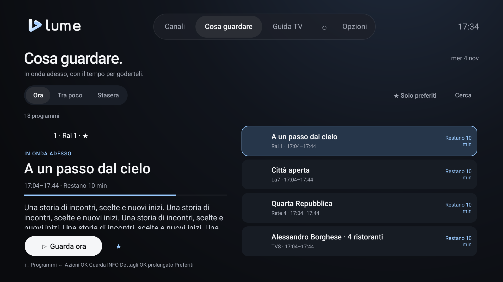
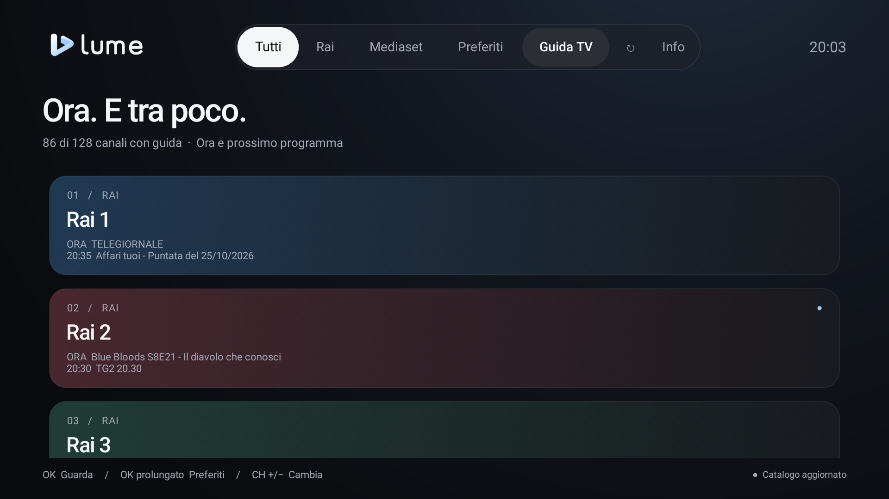
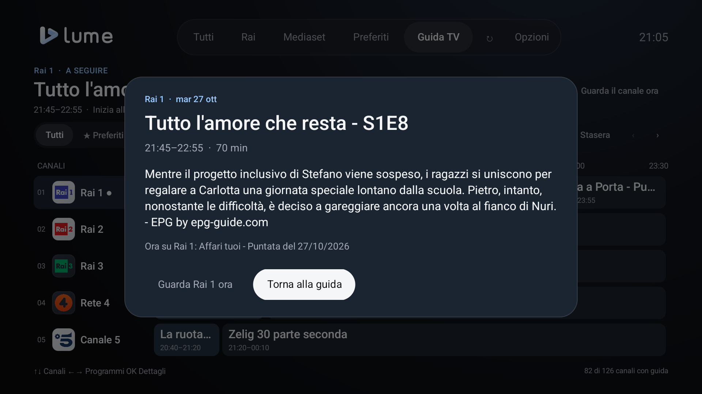
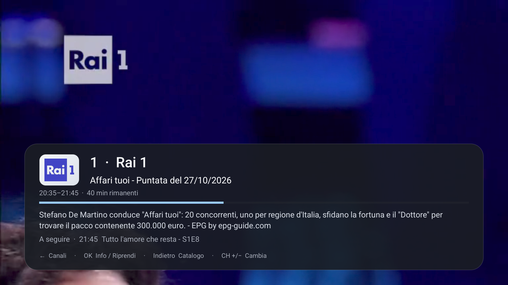
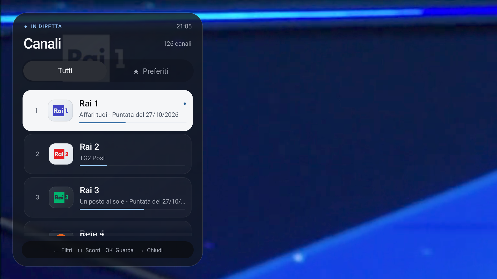

<p align="center">
  <picture>
    <source media="(prefers-color-scheme: dark)" srcset="docs/brand/logo-light.png">
    
  </picture>
</p>

<h1 align="center">La TV, fatta semplice.</h1>
<p align="center">Le dirette italiane su Android TV e smartphone Android, con un’interfaccia dedicata a ogni dispositivo.</p>
<p align="center">
  <a href="https://github.com/pjor94/LumeTV/releases">Tutte le release</a> ·
  <a href="docs/GUIDA-ANDROID-TV.md">Guida Android TV</a> ·
  <a href="docs/GUIDA-SMARTPHONE-ANDROID.md">Guida smartphone Android</a> ·
  <a href="#compilazione">Compila dai sorgenti</a> ·
  <a href="CHANGELOG.md">Novità</a> ·
  <a href="CONTRIBUTING.md">Contribuisci</a>
</p>

> [!TIP]
> ### [Scarica Lume TV 0.9.0 per Android e Android TV](https://github.com/pjor94/LumeTV/releases/download/v0.9.0/LumeTV-0.9.0.apk)
>
> Un’unica APK firmata per **smartphone Android, Android TV e Google TV con Android 6.0 o successivo**. L’interfaccia viene scelta automaticamente in base al dispositivo.
>
> [Apri la release: novità, sorgenti e checksum](https://github.com/pjor94/LumeTV/releases/tag/v0.9.0) · [Guida Android TV](docs/GUIDA-ANDROID-TV.md) · [Guida smartphone](docs/GUIDA-SMARTPHONE-ANDROID.md) · [Istruzioni di installazione](#distribuzione-e-installazione)



Lume TV è un’app per **smartphone Android, Android TV e Google TV** dedicata alla televisione italiana in diretta. Un’unica APK riconosce il dispositivo e apre l’interfaccia per comandi touch o telecomando. Il catalogo ha una schermata propria; quando scegli un canale, il video occupa tutto lo schermo. L’interfaccia è nativa, scritta in Kotlin, e la riproduzione usa AndroidX Media3.

## Grazie a WorldLiveTV

**Questo progetto esiste grazie al lavoro di [WorldLiveTV](https://github.com/WorldLiveTV/WorldLiveTV.github.io) e di WLTV Group.** Il catalogo delle sorgenti e le integrazioni delle emittenti derivano dal loro add-on per Kodi, `plugin.video.wltvhelper`.

Lume TV ne adatta la logica di risoluzione in Kotlin e propone interfacce dedicate ad Android TV e smartphone Android. Il merito della raccolta e della manutenzione delle sorgenti resta al progetto originale e ai suoi collaboratori.

Lume TV è un progetto indipendente, distribuito con licenza **GPL-3.0-or-later**. Non è un’app ufficiale WorldLiveTV né delle emittenti. Versioni di riferimento, file adattati e altre attribuzioni sono raccolti in [THIRD_PARTY_NOTICES.md](THIRD_PARTY_NOTICES.md).

## Novità della 0.9.0

**Opzioni → Le mie liste** permette di gestire le sorgenti attraverso pagine interne nello stile di Opzioni. Nome, accesso ai server, lettura, guida e stato hanno sezioni dedicate; anteprima, errori e conferme restano nella pagina. Indietro conserva campi e posizione, sia con telecomando sia con touch.

Le liste personali accettano **HTTP su consenso per sorgente**, documenti fino a **64 MiB**, **50.000 voci per lista** e **100.000 complessive**. Sono disponibili M3U semplice o estesa, più codifiche, liste incluse, header separati per funzione, loghi autenticati e direttive KODIPROP per le forme ClearKey DASH/CENC e Widevine supportate.

La **guida XMLTV personale** gestisce feed XML/gzip/xz, lingua e orari, associazioni dei canali e ricerca nello storico. Il **catalogo Video** offre ricerca, filtri e ripresa della posizione. Archivio e dall’inizio sono disponibili quando il servizio della lista li supporta, con ritorno alla diretta nello stesso player.

Gli archivi della 0.8.0 vengono migrati conservando ID, preferiti e impostazioni. Le liste personali, la loro guida e gli avanzamenti restano sul dispositivo, esclusi da AURA e dalla Home dei launcher. [Formati, limiti e funzionamento](docs/personal-playlists.md).

## TV, radio e riproduzione continua

Lume TV include le radio italiane WorldRadio di WLTV, con ricerca per nome/città, preferiti e recenti separati dai canali TV.

Sullo smartphone, le radio continuano a suonare a schermo spento e durante l’uso di altre app, con controlli nella notifica, sulla schermata di blocco e dalle cuffie. Il mini player mantiene la riproduzione durante la navigazione nel catalogo. Le dirette TV offrono Picture in Picture sui dispositivi compatibili e un pulsante **Solo audio**; **Opzioni → Qualità e consumo dati** permette di scegliere il risparmio dati quando l’emittente offre più qualità.

Su Android TV, una schermata radio dedicata offre i comandi per telecomando. Tornando al catalogo o aprendo la guida, la diretta prosegue in un’anteprima interna; **Apri la diretta** ritorna al player e **Interrompi** chiude la riproduzione. Uscendo dall’app o passando ad altre app sulla TV, la riproduzione termina.

**Opzioni** è una pagina dedicata su entrambi i dispositivi. Sulla TV mantiene il menu superiore delle altre pagine, con navigazione da telecomando e anteprima della diretta; sul telefono mantiene il mini player. È corretto anche l’arresto involontario della riproduzione cambiando canale dalla lista sulla Bravia.

Il progetto continua a usare un solo player. Timer di spegnimento e integrazioni per l’auto sono esclusi da questa versione. I consumi e l’audio offload vanno verificati su hardware fisico; la modalità solo audio non riduce necessariamente il traffico se la sorgente unisce audio e video nello stesso flusso.

## Funzioni

- **Opzioni → Canali nella Home** pubblica fino a 24 canali del catalogo integrato nei launcher Android TV compatibili, con consenso separato da AURA. [Funzionamento e contratto per launcher](docs/integration-launchers.md).
- Liste M3U personali da URL HTTP/HTTPS o file, con consenso HTTP per sorgente, guida XMLTV, Video e archivio per i servizi compatibili, gestibili in **Opzioni → Le mie liste**, con filtri per sorgente e gruppo. Le liste restano sul dispositivo e sono escluse dalla condivisione AURA e dalla Home dei launcher.
- Canali Rai, Rai/TGR e Mediaset presenti nella lista WLTV, insieme alle altre sorgenti supportate.
- Riproduzione a tutto schermo di flussi HLS e DASH, con supporto Widevine quando richiesto dall’emittente.
- Su TV: navigazione con telecomando, selezione numerica e cambio canale con CH+/CH−.
- Su smartphone Android: navigazione touch con **Canali / Radio / Preferiti / Guida / Scopri**, ricerca e pulsanti per preferiti, pausa/ripresa, cambio canale e schermo intero.
- Elenco canali durante la diretta, con loghi, programma in onda e filtro preferiti, senza interrompere la visione: laterale sulla TV e touch sul telefono.
- Preferiti e memorizzazione dell’ultimo canale guardato. Sulla TV, l’ultimo canale viene riaperto all’avvio; sul telefono si apre il catalogo.
- Cambio canale su tutti i canali o solo sui preferiti, configurabile in **Opzioni**, con CH+/CH− sulla TV e pulsanti precedente/successivo sul telefono.
- Guida TV a griglia sulla TV e per canale sullo smartphone, con dettagli dei programmi e palinsesto conservato sul dispositivo.
- Cosa guardare: programmi **Ora / Tra poco / Stasera**, ricerca, filtro preferiti e avvisi locali per i programmi futuri mentre l’app è aperta. Sulla TV, la vista Focus affianca dettagli ed elenco.
- Informazioni della diretta con titolo, orari, avanzamento e descrizione quando disponibili; sulla TV anche minuti rimanenti e programma successivo.
- Recupero automatico delle interruzioni temporanee, con attesa del ritorno della rete.
- Catalogo aggiornato automaticamente, con una copia locale disponibile al primo avvio.
- Loghi dei canali nel catalogo, nella guida e nel pannello della diretta, scaricati dalle sorgenti originali e conservati sul dispositivo.
- Controllo automatico delle nuove versioni su GitHub e aggiornamento dall’app, da **Opzioni → Aggiornamenti**.
- Collegamento locale facoltativo con AURA: preferiti, guida e apertura dei canali dal launcher, revocabile in **Opzioni → Collegamento con AURA**. [Contratto e configurazione delle firme](docs/integration-aura.md).

Le integrazioni attuali comprendono Rai, Mediaset, Sky, La7, WBD/Discovery e URL diretti. La disponibilità dei singoli canali dipende dalle emittenti, dalla rete utilizzata e dagli eventuali eventi in corso.

<a id="smartphone-android--in-sviluppo"></a>

## Android TV e smartphone Android

Il progetto supporta entrambe le interfacce nella stessa APK, da **Android 6.0 in poi**. Le guide sono separate per dispositivo:

| Dispositivo | Interfaccia automatica | Guida |
| --- | --- | --- |
| Smartphone Android | Comandi touch e navigazione inferiore | [Guida smartphone Android](docs/GUIDA-SMARTPHONE-ANDROID.md) |
| Android TV e Google TV | Telecomando e navigazione con le frecce | [Guida Android TV e Google TV](docs/GUIDA-ANDROID-TV.md) |
| Tablet e altri dispositivi | UI TV; puoi selezionare Smartphone per usare i comandi touch | [Scelta dell’interfaccia](docs/GUIDA-UTENTE.md#quale-interfaccia-si-apre) |

**Opzioni → Interfaccia → Automatica / Smartphone / TV** permette di cambiare modalità. La scelta rimane salvata e conserva catalogo, guida, preferiti e impostazioni sullo stesso dispositivo. Ogni telefono e ogni TV mantiene i propri dati locali.

Durante la diretta sullo smartphone, un tocco sul video mostra i controlli. Il passaggio tra verticale e schermo intero conserva il player e l’eventuale pausa. I collegamenti al canale e all’ultima diretta restano disponibili in entrambe le interfacce.

[Indice delle guide e disponibilità delle versioni](docs/GUIDA-UTENTE.md).

<a id="la-nuova-guida-tv"></a>

## Guida TV e palinsesto

Sulla TV, la griglia mostra circa due ore e mezza alla volta, scorrendo fino alla fine del palinsesto disponibile. ↑/↓ cambia canale mantenendo l’orario, ←/→ passa tra i programmi; **Adesso** e **Stasera** raggiungono le rispettive fasce. OK sul programma in onda apre la diretta; sui programmi futuri mostra orari, descrizione quando disponibile e un’azione esplicita per guardare il canale ora.

Nella Guida, CH+/CH− scorre i canali per pagina e i numeri raggiungono il canale senza avviare la riproduzione. OK prolungato gestisce i preferiti. Tornando dalla diretta si ritrovano canale e fascia oraria selezionati. I canali privi di palinsesto restano accessibili; disponibilità e copertura dipendono dalla sorgente.

Sullo smartphone, **Guida** mostra un canale alla volta: tocca il suo nome seguito da **Cambia**, scegli **Da adesso** o **Stasera** e apri un programma per leggerne i dettagli. **Scopri** permette di cercare tra i programmi dei diversi canali.



<details>
  <summary>Altre schermate: dettagli, informazioni e canali durante la diretta</summary>

**I dettagli del programma** — titolo completo, orari e descrizione, quando fornita dal palinsesto.



**Le informazioni della diretta** — descrizione del programma attuale, avanzamento e titolo successivo.



**I canali, senza lasciare la visione** — elenco laterale con filtro preferiti e programma in onda.



</details>

Per le istruzioni illustrate su installazione, preferiti, palinsesto e aggiornamenti, consulta la **[guida Android TV](docs/GUIDA-ANDROID-TV.md)** o la **[guida smartphone Android](docs/GUIDA-SMARTPHONE-ANDROID.md)**.

## Distribuzione e installazione

Le [release su GitHub](https://github.com/pjor94/LumeTV/releases) contengono l’APK firmata `LumeTV-<versione>.apk`, i sorgenti completi della stessa versione, l’impronta del certificato e i checksum SHA-256. GitHub Actions esegue test, Lint e compilazione prima della pubblicazione. Le nuove versioni usano numeri come `0.3.1` e sono pubblicate come normali release.

Lume TV **0.9.0** supporta **smartphone Android, Android TV e Google TV con Android 6.0 o successivo** nella stessa APK. Le versioni fino alla **0.5.3** comprendono soltanto la UI TV.

Su Android 9 e 10, le versioni fino alla 0.6.0 possono bloccare l’aggiornamento dall’app con un falso errore di firma. Installa manualmente l’APK ufficiale 0.9.0 sopra quella esistente, senza disinstallare: preferiti e impostazioni vengono conservati e i prossimi aggiornamenti potranno usare il controllo corretto.

La versione TV è stata provata anche su Sony Bravia KD-55X81J con Android 12. Le due interfacce attuali sono state collaudate su emulatori Android TV e smartphone; codec e DRM possono comportarsi diversamente sui dispositivi fisici.

1. Scarica un’APK adatta al tuo dispositivo dagli allegati della [release desiderata](https://github.com/pjor94/LumeTV/releases), oppure compila un’APK di sviluppo seguendo [Compilazione](#compilazione).
2. Apri l’APK sulla TV o sul telefono con un gestore file.
3. Se Android lo richiede, autorizza l’installazione per il gestore file utilizzato.

Puoi installarla anche con ADB, dopo aver collegato e autorizzato il dispositivo:

```sh
adb install -r LumeTV-VERSIONE.apk
```

Sostituisci `VERSIONE` con la versione scaricata. Gli aggiornamenti delle release usano la stessa chiave di firma. Se hai già installato una build debug o firmata con un’altra chiave, Android può richiedere di disinstallarla prima, cancellando preferiti e impostazioni locali.

### Aggiornamenti dall’app

Le versioni che includono l’aggiornatore controllano le release pubbliche di `pjor94/LumeTV` all’avvio, se sono trascorsi almeno 30 minuti dall’ultimo controllo riuscito, e ogni 30 minuti mentre l’app è in uso. Quando è disponibile una nuova versione compatibile, un popup nel catalogo propone **Aggiorna** o **Più tardi**. Durante una diretta il popup attende il ritorno al catalogo. **Più tardi** o Indietro lo rinviano al prossimo avvio dell’app; il pulsante nel catalogo e **Opzioni → Aggiornamenti** restano disponibili. Il controllo non viene eseguito a dispositivo spento o con l’app chiusa. In caso di errore attende un’ora, o più a lungo se GitHub richiede una pausa.

Scegli **Scarica e aggiorna** per scaricare l’APK, verificarne dimensione, SHA-256, package, versione e certificato di firma e aprire il programma di installazione Android. Se richiesto, consenti a **Lume TV** di installare app, poi conferma l’aggiornamento sul dispositivo. La sostituzione dell’app può chiudere Lume: riaprila dal launcher. Preferiti e impostazioni vengono conservati negli aggiornamenti con la stessa firma. Puoi annullare un download o rinviare l’installazione; il controllo e il download non richiedono un account GitHub.

Nella stessa schermata puoi disattivare i controlli automatici. Vengono proposte soltanto release pubblicate con `versionCode` maggiore e compatibili con Android sul dispositivo. Le vecchie release prive di `update.json` non vengono proposte. Il controllo considera fino a 100 release e verifica i metadati delle 20 più recenti ammesse agli aggiornamenti.

La prima APK contenente l’aggiornatore va installata con la procedura manuale indicata sopra. Le build debug o con firma personalizzata non possono installare gli aggiornamenti ufficiali sopra la propria firma.

<a id="telecomando"></a>

## Telecomando su Android TV

| Tasto | Azione |
| --- | --- |
| Frecce e OK | Sfoglia il catalogo e apri un canale |
| Indietro durante la diretta | Torna al catalogo |
| Indietro da Canali | Chiede conferma per chiudere l’app |
| Indietro da Guida TV o Cosa guardare | Chiude la ricerca o i dettagli aperti, poi torna a Canali |
| CH+/CH− | Passa al canale successivo o precedente |
| Numeri | Seleziona il numero del canale |
| OK durante la diretta | Mostra le informazioni e riprende la riproduzione se in pausa |
| ← durante la diretta | Apre l’elenco canali sulla sinistra, mantenendo la diretta in riproduzione |
| ↑/↓ e OK nell’elenco laterale | Scorre i canali e apre quello scelto |
| → da un canale, oppure Indietro | Chiude l’elenco laterale e continua la visione |
| OK prolungato su una scheda | Aggiunge o rimuove un preferito |
| ↻ | Aggiorna catalogo e guida |

I tasti GUIDE e MENU aprono guida e catalogo quando il sistema della TV li rende disponibili all’app.

Per chiudere Lume TV scegli **Esci**, in alto dopo **Opzioni**, oppure premi **Indietro** dalla Home di Canali. La conferma apre con **Annulla** selezionato: scegli **Esci** per chiudere, oppure **Annulla** o Indietro per continuare. Il pulsante è disponibile anche in Guida TV e Cosa guardare. Preferiti, impostazioni e ultimo canale guardato vengono conservati.

In **Opzioni → CH+/CH−** puoi scegliere **Solo preferiti**. La scelta resta salvata sul dispositivo; i numeri e la selezione dal catalogo continuano ad accedere a tutti i canali. Se non hai preferiti, l’app ti invita ad aggiungerli con OK prolungato su una scheda.

Durante la diretta, OK o INFO mostra gli orari del programma, l’avanzamento, i minuti rimanenti, la descrizione e il titolo successivo, quando disponibili. Le descrizioni lunghe si leggono con **↑/↓**, mantenendo il video in riproduzione e fino a tre righe visibili. Il pannello resta per 15 secondi quando viene aperto con OK o INFO e contiene una descrizione; ogni scorrimento rinnova il tempo di lettura. Al cambio canale, o senza descrizione, resta per sei secondi. Si aggiorna anche al cambio di programma.

Premi **←** per aprire l’elenco laterale: il focus parte dal canale in visione, contrassegnato da un punto azzurro. **↑/↓** scorre i canali senza cambiare la diretta; **OK** conferma la scelta e chiude l’elenco. I loghi, il programma in onda e la barra di avanzamento aiutano a scegliere. Una seconda pressione di **←** porta ai filtri **Tutti** e **Preferiti** in cima all’elenco; il filtro non modifica la modalità CH+/CH− delle Opzioni. **→** da un canale o **Indietro** richiude il pannello senza interrompere il video. L’apertura è immediata e la navigazione rispetta le animazioni disabilitate nelle impostazioni della TV.

Per le interruzioni recuperabili, Lume prova a riaprire la diretta fino a tre volte, dopo 2, 5 e 10 secondi, richiedendo nuovamente l’indirizzo del flusso. Se manca la connessione, attende che torni. I tentativi si annullano cambiando emittente, mettendo in pausa o interrompendo la riproduzione; sulla TV si annullano anche uscendo dall’app o entrando in standby. Gli errori DRM, i formati non supportati e le richieste di pausa del servizio restano gestiti con un messaggio e il pulsante **Riprova**.

## Catalogo e guida

Il catalogo viene aggiornato ogni 24 ore mentre usi l’app. La lista inclusa nell’APK serve per il primo avvio: nomi, numerazioni e nuovi canali delle integrazioni supportate arrivano direttamente dal servizio WLTV.

RSI La1 e RSI La2 sono escluse dal catalogo incluso, dalla cache e dagli aggiornamenti, anche quando presenti nella lista sorgente.

La guida usa il servizio [EPG-Guide](https://epg-guide.com/) e si aggiorna ogni sei ore. Non tutti i canali hanno un palinsesto disponibile. In caso di errore o di pausa richiesta dal servizio, Lume conserva i programmi già scaricati e riprova in seguito.

I loghi del catalogo, della guida e del pannello della diretta vengono scaricati direttamente dagli indirizzi della playlist e della guida, poi conservati sul dispositivo. Le immagini salvate vengono ricontrollate dopo sette giorni e rimangono disponibili quando la sorgente non risponde. Le edizioni TGR possono condividere il marchio Rai 3, mantenendo separati i programmi regionali. Quando manca un logo, il suo spazio resta vuoto e il nome del canale rimane visibile, mantenendo gli allineamenti delle schede. Alcune sorgenti di immagini usano HTTP: le eccezioni sono limitate alle destinazioni previste e il download controlla anche i redirect.

Il pulsante ↻ permette di richiedere un aggiornamento. Le modifiche alle API delle emittenti possono invece richiedere una nuova versione dell’app.

## Compilazione

Servono JDK 17 e Android SDK 36. Configura l’SDK in Android Studio oppure nel file locale `local.properties`.

```sh
./gradlew :core:test :app:testDebugUnitTest :app:lintDebug :app:assembleDebug
```

L’APK di sviluppo con entrambe le interfacce si trova in `app/build/outputs/apk/debug/app-debug.apk`. Per installarla su un telefono o una TV collegati e autorizzati con ADB:

```sh
adb install -r app/build/outputs/apk/debug/app-debug.apk
```

Per contribuire, eseguire i test di rete o rigenerare le risorse grafiche, consulta [CONTRIBUTING.md](CONTRIBUTING.md).

La compilazione e l’installazione locali restano disponibili. La configurazione della firma e la pubblicazione automatica dell’APK e dei sorgenti tramite tag sono descritte in [docs/RELEASE.md](docs/RELEASE.md).

## Privacy

Lume TV non richiede un account e non contiene telemetria. Catalogo, guida e preferiti vengono conservati sul dispositivo; le sessioni anonime Mediaset restano in memoria. Per funzionare, l’app contatta i servizi di WLTV, EPG-Guide e delle emittenti. Il controllo aggiornamenti e il download delle APK contattano GitHub; puoi disattivare il controllo automatico nelle Opzioni.

## Sorgenti e diritti

Lume TV è un client indipendente per la riproduzione di dirette televisive. Il catalogo e parte della logica delle integrazioni derivano dal progetto WorldLiveTV, come documentato nelle attribuzioni.

L’app contatta endpoint esposti su Internet dai servizi sorgente e riproduce i flussi direttamente sul dispositivo, senza ospitare o ritrasmettere le trasmissioni attraverso server del progetto. Alcune integrazioni richiedono sessioni anonime, token temporanei o il normale processo DRM previsto dal fornitore. La raggiungibilità tecnica di un endpoint **non costituisce un’autorizzazione** a utilizzarlo o a distribuirne i contenuti tramite un client di terzi. Non garantiamo che tutti gli endpoint siano sempre accessibili o utilizzabili in ogni territorio.

Disponibilità e accesso dipendono dai fornitori, dai diritti territoriali e dalle condizioni applicabili. Gli utenti devono rispettare tali condizioni e utilizzare il software nei limiti dei diritti di cui dispongono. Il progetto non concede diritti su trasmissioni, palinsesti, marchi o loghi delle emittenti e non è affiliato alle emittenti né a WorldLiveTV.

### Garanzie e responsabilità

Il software è fornito «così com’è», senza garanzie, nella misura consentita dalla legge e secondo le sezioni 15–17 della GNU GPL. Nella stessa misura, autori e contributori escludono la responsabilità per danni derivanti dall’uso del software. Questa dichiarazione non esclude responsabilità inderogabili, non autorizza utilizzi illeciti e non impedisce ai titolari dei diritti di farli valere. Non costituisce un esonero assoluto da ogni responsabilità.

### Segnalazioni e richieste di rimozione

Per chiedere la rimozione di un canale o segnalare un problema relativo ai diritti, [apri una issue nel repository](https://github.com/pjor94/LumeTV/issues/new?template=rights.yml). Indica il canale, la sorgente interessata, il motivo della richiesta e, se agisci per un titolare, elementi utili a verificarne la titolarità o la delega. Non pubblicare credenziali, token o dati personali riservati nelle issue pubbliche.

Le segnalazioni saranno esaminate e, quando necessario, il canale o l’integrazione saranno rimossi o disabilitati, adottando misure per impedirne la reintroduzione dagli aggiornamenti. La rimozione può richiedere una nuova versione dell’app e non modifica copie già scaricate. Non è necessario avviare una contestazione formale su GitHub per contattare il progetto.

## Licenza

Il codice e le risorse originali di Lume TV sono distribuiti sotto [GNU GPL versione 3 o successiva](LICENSE). Le integrazioni derivate da WorldLiveTV mantengono la stessa licenza. Crediti, avvisi di modifica e licenze delle dipendenze sono in [THIRD_PARTY_NOTICES.md](THIRD_PARTY_NOTICES.md) e nell’app in **Opzioni → Licenze e avvisi**. Gli archivi sorgente completi comprendono anche le dipendenze descritte in [third_party/README.md](third_party/README.md). Chi ridistribuisce una propria APK deve rispettare gli obblighi di disponibilità dei sorgenti previsti dalle licenze applicabili. Nomi, loghi e trasmissioni delle emittenti appartengono ai rispettivi titolari.
