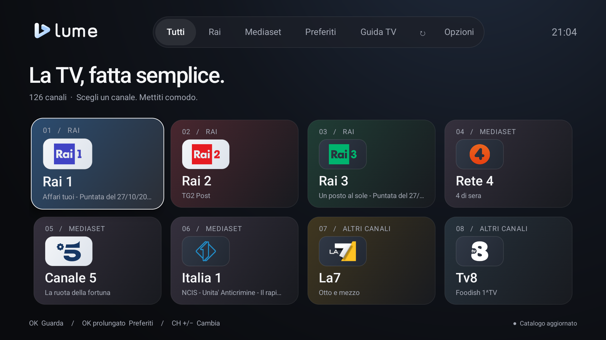
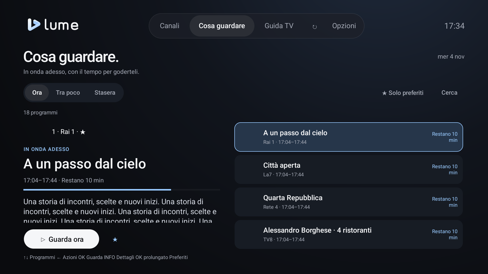
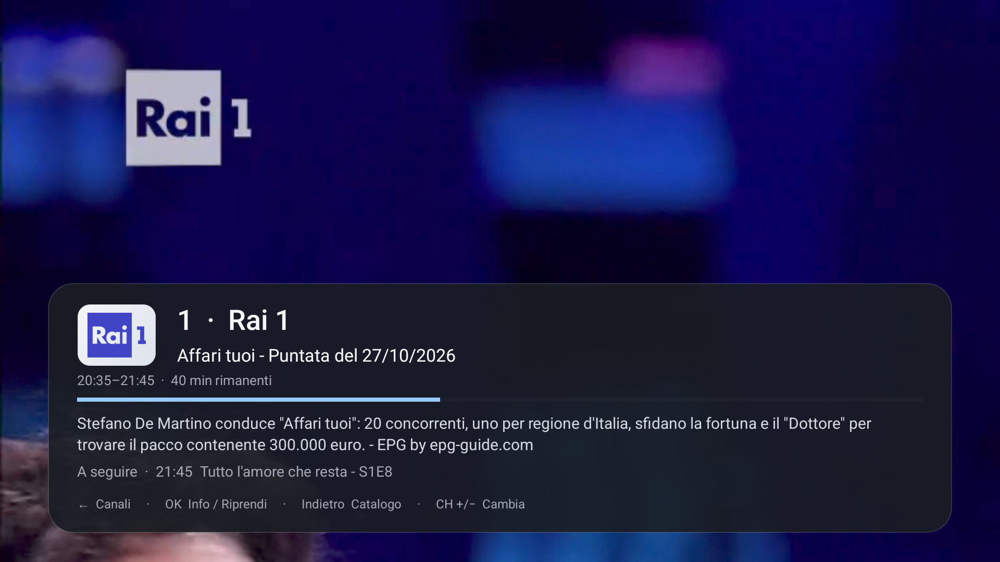
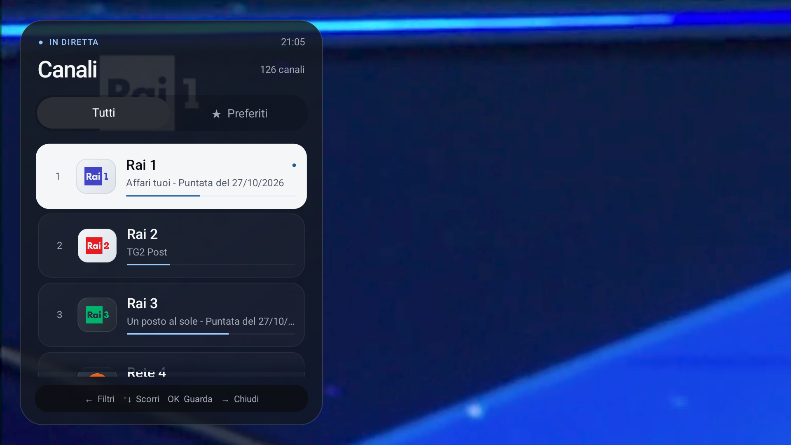
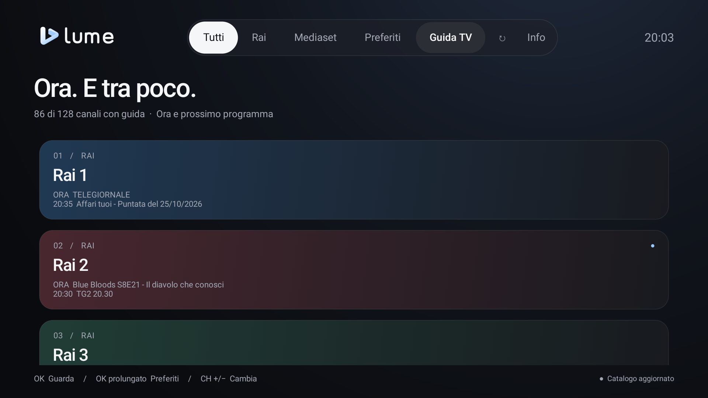
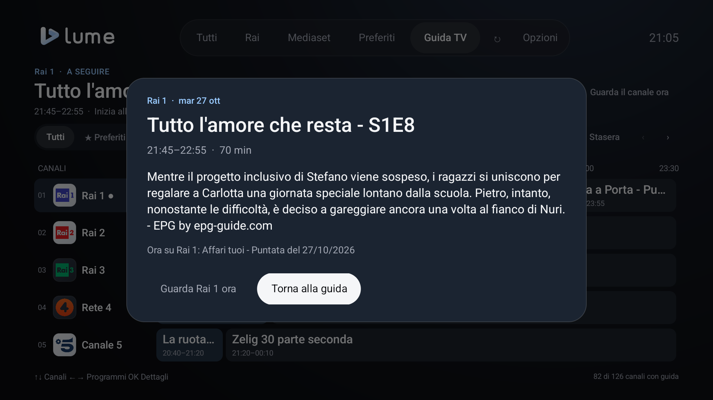

# Guida Lume TV per Android TV e Google TV

La TV, fatta semplice. Lume TV porta le dirette italiane su Android TV e Google TV: scegli un canale, guarda a tutto schermo e scopri cosa c’è nelle prossime ore con lo stesso telecomando.

Questa guida descrive l’interfaccia per telecomando. Se usi un telefono, consulta la [guida per smartphone Android](GUIDA-SMARTPHONE-ANDROID.md).

Questa guida descrive **Lume TV 0.10.0**, con liste personali, canali nella Home dei launcher, radio, anteprima durante la navigazione e pagina Opzioni con menu superiore. Le versioni fino alla 0.5.3 comprendono soltanto la UI TV e non hanno la scelta dell’interfaccia.

[Download e installazione](../README.md#distribuzione-e-installazione) · [Tutte le guide](GUIDA-UTENTE.md) · [Torna al progetto](../README.md) · [Novità](../CHANGELOG.md)

## In questa guida

- [Liste personali](#liste-personali)
- [Video on demand](#video-on-demand)
- [Canali nella Home](#canali-nella-home)
- [Installazione e primo avvio](#installazione-e-primo-avvio)
- [Scegliere l’interfaccia](#scegliere-linterfaccia)
- [Scegliere un canale](#scegliere-un-canale)
- [Cosa guardare](#cosa-guardare)
- [Informazioni durante la visione](#informazioni-durante-la-visione)
- [Elenco canali durante la diretta](#elenco-canali-durante-la-diretta)
- [Consultare la Guida TV](#consultare-la-guida-tv)
- [Preferiti e cambio canale](#preferiti-e-cambio-canale)
- [Aggiornare Lume TV](#aggiornare-lume-tv)
- [Uscire dall’app](#uscire-dallapp)
- [Telecomando: riferimento rapido](#telecomando-riferimento-rapido)
- [Se qualcosa non funziona](#se-qualcosa-non-funziona)
- [Dati e collegamento con AURA](#dati-e-collegamento-con-aura)

## Canali nella Home

Apri **Opzioni → Canali nella Home → Attiva e scegli canali**. Scegli **I miei preferiti** per seguire i preferiti del catalogo integrato, oppure **Selezione manuale** per scegliere fino a 24 canali e premi **Pubblica**. Se Android chiede di aggiungere la riga Lume TV, conferma. In altri launcher puoi abilitarla dalle loro impostazioni dei canali.

Su **Projectivy 4.73**, dopo aver consentito la lettura degli elenchi TV al launcher, apri **Edit channels → Lume TV → Visible** per rendere visibile la riga. Se la riga non compare, usa prima **Mostra nella Home** in Lume e conferma l’eventuale richiesta Android.

Le tessere aprono la diretta dentro Lume. Nomi, immagini e programma in onda vengono condivisi con la Home; radio e liste personali sono escluse. Il consenso è separato da AURA. I programmi scaduti tornano alla descrizione del canale al successivo aggiornamento; il sistema può ritardare i lavori in background.

**Mostra nella Home** richiede nuovamente la visualizzazione della riga. **Ripristina tessere rimosse** recupera i canali che hai rimosso dalla Home; la conferma di una selezione manuale ripubblica i canali scelti. **Disattiva e rimuovi** elimina la pubblicazione. La visibilità e l’ordine dipendono dal launcher; la funzione richiede Android TV 8 o successivo e non equivale all’inserimento nella scheda Live di Google TV.

## Liste personali

Apri **Opzioni → Le mie liste → Aggiungi URL** e assegna un nome alla sorgente. Sono accettati indirizzi HTTPS e, selezionando **Consenti HTTP per questa lista**, anche HTTP. **Importa file** usa il selettore documenti Android, quando disponibile. Scegli TV o radio come tipo predefinito per le voci che non lo indicano.

**Verifica lista** mostra avanzamento e anteprima con voci importabili, escluse e duplicate; **Interrompi verifica** conserva i dati inseriti. Conferma con **Importa lista** o **Sostituisci lista**. I file sono copiati nell’archivio privato: spostare l’originale non rende indisponibili i canali.

La gestione usa pagine nello stile di **Opzioni**, con salvataggio esplicito ed errori e conferme nella pagina. **Sorgente** modifica nome, attivazione, consenso HTTP e URL/file. **Lettura e contenuti** contiene formato, codifica, gruppi e aggiornamento; **Accesso ai server** contiene header, server autorizzati, cookie e HTTP dei loghi. **Stato e ultima importazione** riporta metadati e motivi degli scarti. **Indietro** conserva i campi tornando dalle sottosezioni e propone di continuare o scartare eventuali modifiche non salvate.

Nel catalogo, **Lista** seleziona la sorgente e **Tutti i gruppi** restringe l’elenco. Preferiti e cambio canale mantengono la distinzione tra TV, radio e sorgenti. Gli aggiornamenti conservano la riproduzione e l’ultima copia valida. Disattivare conserva i dati; eliminare rimuove anche preferiti, guida e avanzamenti associati e interrompe la relativa riproduzione.

Limiti: **10 liste, 500.000 voci lette per sorgente, un milione di voci importate complessive e 256 MiB per documento**. Il catalogo scorre in continuo; ricerca e gruppi considerano l’intera lista. Sono disponibili M3U semplice o estesa, UTF-8/Windows-1252/Latin-1, liste incluse e le forme di header, KODIPROP e ClearKey DASH/CENC documentate. HTTP invia senza cifratura indirizzi e dati di accesso; i consensi di lista, loghi e guida restano separati.

**Guida e archivio** configura gli indirizzi XMLTV, gli orari, le associazioni dei canali e l’archivio. La guida personale supporta XML/gzip/xz, ricerca e storico fino a sette giorni. La voce **Video** nella barra principale compare solo con VOD in almeno una lista abilitata e apre la biblioteca con copertine, Film, Serie, ricerca e scorrimento continuo; il player conserva la posizione. Dalla guida puoi scegliere **Rivedi dall’archivio** o **Guarda dall’inizio**, quando il servizio li supporta; **Torna alla diretta** lascia il replay. Questa funzione non registra i programmi sul dispositivo.

Gli archivi della 0.8.0 vengono migrati conservando ID, preferiti e impostazioni. Liste, guida personale e avanzamenti restano locali ed esclusi da AURA e dalla Home dei launcher. [Formati, limiti e funzionamento](personal-playlists.md).

Se la TV non offre un selettore documenti, la pagina indica di usare un URL. L’apertura di un selettore esterno segue le normali regole della UI TV; i comandi di riproduzione nella gestione consentono di riaprire o interrompere il contenuto corrente.

## Video on demand

Se almeno una lista abilitata contiene video, nella barra principale compare **Video**, tra **Canali** e **Radio**. La home mostra copertine e raccolte Film, Serie, Continua a guardare e La mia lista. **Mostra tutto** apre la raccolta completa; **Cerca** e **Filtri** permettono di restringere i risultati per titolo, lista, categoria e ordine.

Seleziona una copertina per aprire la scheda del titolo. **Guarda** o **Riprendi** avvia il player; **Dall’inizio** riparte da zero. Le serie riconosciute raggruppano stagioni ed episodi. Tornando dal player o passando tra le sezioni si conservano pagina e posizione. Copertine e informazioni dipendono dai dati presenti nella lista.

Il menu superiore resta disponibile. Usa le frecce del telecomando per scorrere copertine e raccolte; **Indietro** torna al livello precedente e conserva il focus.

## Installazione e primo avvio

Serve una TV o un dispositivo con **Android TV o Google TV, Android 6.0 o successivo**, collegato a Internet.

1. Scarica [LumeTV-0.10.0.apk](https://github.com/pjor94/LumeTV/releases/download/v0.10.0/LumeTV-0.10.0.apk), oppure ottienila seguendo [Compilazione](../README.md#compilazione).
2. Trasferiscilo sulla TV e aprilo con un gestore file. Se Android lo richiede, autorizza quel gestore a installare applicazioni.
3. Conferma l’installazione e apri **Lume TV** dal launcher della TV.
4. Scegli un canale con le frecce e premi **OK**.

Al primo avvio trovi già una lista di canali. Catalogo, guida e loghi si aggiornano quando la rete è disponibile. Lume non richiede la creazione di un account.

Se l’app è già installata da una release ufficiale, segui [Aggiornare Lume TV](#aggiornare-lume-tv): gli aggiornamenti conservano preferiti e impostazioni.

## Scegliere l’interfaccia

Da Lume TV 0.6.0, **Opzioni → Interfaccia** offre tre scelte:

- **Automatica:** riconosce Android TV e Google TV e apre la UI per telecomando. Sui telefoni Android apre quella touch; tablet e altri dispositivi mantengono la UI TV.
- **TV:** usa sempre l’interfaccia descritta in questa guida.
- **Smartphone:** usa l’interfaccia touch descritta nella [guida per smartphone Android](GUIDA-SMARTPHONE-ANDROID.md).

La scelta rimane salvata sul dispositivo. Cambiare interfaccia conserva catalogo, guida, preferiti e impostazioni sullo stesso dispositivo. Ogni telefono o TV mantiene i propri dati locali.

## Scegliere un canale

Nel catalogo trovi numero, nome e logo dei canali. Il menu superiore contiene **Canali**, **Radio**, **Cosa guardare**, **Guida TV**, **Opzioni** ed **Esci**, e rimane disponibile nella pagina Opzioni. **Video** si aggiunge tra Canali e Radio quando almeno una lista abilitata contiene VOD. All’interno di Canali, i filtri **Tutti**, **Rai**, **Mediaset**, **Preferiti** e **Recenti** permettono di restringere l’elenco.

- Usa le **frecce** per spostare la selezione: la scheda evidenziata è quella che aprirai.
- Premi **OK** per guardare il canale a tutto schermo.
- Digita un **numero** per raggiungere direttamente il canale corrispondente.
- Premi **Indietro** durante la visione per tornare al catalogo; dalla Home di Canali, Indietro chiede conferma per chiudere l’app.

L’app ricorda l’ultimo canale riprodotto e lo riapre al successivo avvio, se ancora disponibile.

## Cosa guardare

Apri **Cosa guardare** dalla navigazione in alto. La vista Focus mostra i dettagli del programma selezionato sulla sinistra e l’elenco dei programmi sulla destra. La selezione da sola non avvia la diretta.

- **Ora** mostra il programma in onda di ogni canale. I preferiti compaiono per primi; i programmi vicini alla fine sono segnalati e seguono gli altri dello stesso gruppo.
- **Tra poco** mostra il prossimo programma di ogni canale che inizia entro 90 minuti, in ordine di inizio.
- **Stasera** mostra fino a due programmi per canale che occupano parte della fascia 20:30–24:00 di oggi, secondo il fuso della TV.
- **Solo preferiti** restringe i risultati. **Cerca** cerca parole nei titoli, nelle descrizioni e nei nomi dei canali della fascia selezionata; accenti e maiuscole non cambiano i risultati.

Usa **↑/↓** per scegliere il programma, **←** per raggiungere le azioni sulla sinistra e **→** per tornare all’elenco. **OK** guarda un programma in onda o attiva/disattiva il promemoria per uno futuro. **INFO** apre la descrizione completa; **OK prolungato** e la stella a sinistra gestiscono il canale preferito. **CH+/CH−** scorre per pagina. I numeri selezionano un canale nei risultati senza avviare la diretta. Nella ricerca, i numeri vengono scritti nel testo.

**Avvisami** salva il promemoria sulla TV. Lume mostra un avviso circa due minuti prima mentre l’app è aperta; puoi scegliere **Guarda ora** o **Più tardi**. La diretta non cambia automaticamente. Gli avvisi non vengono mostrati fuori dall’app né riproposti dopo un lungo standby. Per annullare un promemoria, scegli di nuovo **Avviso attivo** sul programma.

Fascia, ricerca, filtro e programma selezionato vengono conservati. Dopo la riproduzione, Indietro torna alla stessa consultazione. I risultati dipendono dai palinsesti disponibili; **Apri i canali** permette di raggiungere anche i canali privi di guida.

## Informazioni durante la visione

Premi **OK** oppure **INFO** mentre guardi un canale. Il pannello mostra, quando il palinsesto li fornisce:

- Titolo del programma attuale e orari di inizio e fine.
- Avanzamento e minuti rimanenti.
- Descrizione del programma.
- Titolo e orario del programma successivo.

Le descrizioni occupano fino a tre righe alla volta. Se il testo continua, compare **↑↓ Leggi la descrizione completa**: usa le frecce **su e giù** per scorrerlo. Il video continua a essere riprodotto.

Aprendo il pannello con OK o INFO, hai **15 secondi** per leggere una descrizione; ogni scorrimento rinnova questo tempo. Al cambio canale, o quando manca una descrizione, il pannello si richiude dopo **sei secondi**. Le informazioni si aggiornano al cambio di programma.

Se hai messo la riproduzione in pausa con il tasto Play/Pausa, **OK** la riprende e mostra le informazioni.

## Elenco canali durante la diretta

Premi **←** durante la visione. Si apre un elenco laterale e il focus parte dal canale attivo, indicato da un punto azzurro.

1. Usa **↑/↓** per scorrere i canali: il video resta sul canale che stai guardando.
2. Premi **OK** per guardare il canale evidenziato e richiudere l’elenco.
3. Per richiuderlo senza cambiare canale, premi **→** da una riga oppure **Indietro**.

Premendo ancora **←** da una riga raggiungi i filtri **Tutti** e **Preferiti**. Questo filtro riguarda solo l’elenco; la modalità di cambio canale con CH+/CH− si sceglie nelle Opzioni.

## Consultare la Guida TV

Apri **Guida TV** dalle sezioni in alto. La griglia affianca i canali e i programmi lungo una scala oraria comune: la larghezza di ogni programma rappresenta la sua durata. In alto trovi il titolo completo e gli orari dell’elemento selezionato.

| Comando | Nella Guida TV |
| --- | --- |
| ↑/↓ | Cambia canale mantenendo come riferimento l’orario che stai consultando |
| ←/→ | Passa tra i programmi e scorre la fascia oraria quando necessario |
| Adesso | Torna alla programmazione attuale |
| Stasera | Raggiunge la fascia delle 21:00, o quella attuale se è già più tardi |
| Frecce orarie nei controlli | Sposta la fascia mostrata di un’ora |
| CH+/CH− | Scorre i canali per pagina |
| Numeri | Seleziona un canale nella griglia |
| Tutti / Preferiti | Filtra i canali della guida |

La griglia mostra circa **due ore e mezza** alla volta e permette di consultare le ore successive fino alla fine dei dati disponibili.

**Per guardare:** premi **OK** sul programma in onda. Anche le righe senza palinsesto consentono di aprire il canale.

**Per informarti su un programma futuro:** selezionalo e premi **OK**. La scheda riporta titolo, orari e descrizione, quando disponibile. **INFO** apre i dettagli anche per il programma in onda.

Nella scheda, **Guarda [canale] ora** apre la diretta attuale del canale. Un programma futuro non può essere riprodotto in anticipo. **Torna alla guida** o **Indietro** chiude la scheda e ripristina la selezione.

La selezione di un programma futuro, oppure del canale tramite i numeri, non avvia automaticamente il video. Tornando dalla diretta alla Guida ritrovi il canale e la fascia oraria che stavi consultando.

Se mancano informazioni, compare **Programmazione non disponibile**. Il canale resta accessibile. Palinsesti, descrizioni e copertura dipendono dalla sorgente e possono cambiare.

## Preferiti e cambio canale

Per aggiungere o rimuovere un preferito, **tieni premuto OK** su una scheda del catalogo o su un programma nella Guida TV. Trovi i canali salvati nella sezione **Preferiti** e nei filtri della Guida e dell’elenco laterale.

Per usare CH+/CH− solo sui tuoi preferiti:

1. Apri **Opzioni** dal catalogo.
2. Scegli **CH+/CH−**.
3. Seleziona **Solo preferiti**. Per tornare al comportamento iniziale, scegli **Tutti i canali**.

La scelta resta salvata sulla TV. I numeri e il catalogo continuano ad accedere a tutti i canali. Nella Guida TV, CH+/CH− scorre sempre per pagina.

## Aggiornare Lume TV

1. Dal catalogo apri **Opzioni → Aggiornamenti → Controlla ora**.
2. Se è disponibile una nuova versione, scegli **Scarica e aggiorna**.
3. Attendi la verifica del download. Se Android lo richiede, consenti a **Lume TV** di installare applicazioni.
4. Conferma l’aggiornamento nel programma di installazione Android e riapri Lume TV.

Gli aggiornamenti ufficiali conservano preferiti e impostazioni. Puoi annullare il download o rinviare l’installazione.

Il controllo automatico avviene all’avvio, se sono trascorsi almeno 30 minuti dall’ultimo controllo riuscito, e ogni 30 minuti mentre usi l’app. Se trova una nuova versione compatibile, mostra un popup nel catalogo: **Aggiorna** apre la schermata Aggiornamenti; **Più tardi** o Indietro rinviano l’avviso al prossimo avvio. Il focus iniziale è su **Più tardi**. Durante una diretta il popup attende il ritorno al catalogo. Il pulsante di aggiornamento nel catalogo resta disponibile anche dopo il rinvio.

Puoi disattivare i controlli automatici nella schermata Aggiornamenti. In caso di errore l’app attende un’ora, o più a lungo se GitHub richiede una pausa. Se manca l’aggiornatore in una vecchia versione, installa manualmente l’APK dell’ultima release.

Catalogo e palinsesti hanno aggiornamenti separati: il **catalogo ogni 24 ore**, la **guida ogni sei ore**. **↻** nel catalogo richiede un aggiornamento di entrambi.

## Uscire dall’app

Scegli **Esci** nella navigazione in alto, subito dopo **Opzioni**. Il pulsante è disponibile in **Canali**, **Cosa guardare** e **Guida TV**. Puoi aprire la stessa conferma premendo **Indietro** dalla Home di Canali, anche quando hai già guardato una diretta.

Alla domanda **Uscire da Lume TV?**, il pulsante **Annulla** è selezionato all’apertura. Scegli **Esci** per chiudere l’app; **Annulla** o **Indietro** chiude soltanto la conferma e ti lascia sulla schermata. Preferiti, impostazioni e ultimo canale guardato vengono conservati.

Durante la diretta, Indietro torna prima al catalogo o alla consultazione da cui hai aperto il canale. Da Guida TV e Cosa guardare, Indietro chiude prima eventuali dettagli o ricerca aperti, poi torna a **Canali → Tutti**; un’altra pressione apre la conferma di uscita.

## Telecomando: riferimento rapido

| Dove sei | Tasto | Azione |
| --- | --- | --- |
| Catalogo | Frecce, OK | Scegli e apri un canale |
| Catalogo o Guida | OK prolungato | Aggiungi o rimuovi un preferito |
| Diretta | OK / INFO | Mostra le informazioni del programma |
| Informazioni con testo lungo | ↑/↓ | Scorri la descrizione |
| Diretta | ← | Apri l’elenco canali |
| Elenco canali | ↑/↓, OK | Scegli un canale e conferma il cambio |
| Elenco canali | → dalla riga / Indietro | Chiudi l’elenco |
| Diretta | CH+/CH− | Cambia canale secondo la modalità scelta |
| Diretta o catalogo | Numeri | Apri un canale per numero |
| Guida | Numeri | Seleziona la riga senza avviare la diretta |
| Guida | CH+/CH− | Scorri per pagina |
| Cosa guardare | ↑/↓, ←/→ | Seleziona un programma e raggiungi le azioni |
| Cosa guardare | OK / INFO | Guarda o imposta un avviso / leggi i dettagli |
| Diretta | Indietro | Torna al catalogo |
| Home di Canali | Indietro | Chiedi conferma per chiudere l’app |
| Guida TV / Cosa guardare | Indietro | Chiudi dettagli o ricerca aperti, poi torna a Canali |
| Conferma di uscita | Indietro | Annulla e continua a usare Lume TV |
| App | GUIDE / MENU | Apri Guida / catalogo, se la TV inoltra il tasto all’app |

Alcuni telecomandi riservano GUIDE, MENU o INFO alle funzioni della TV. Puoi sempre aprire la Guida dalla navigazione del catalogo e mostrare le info della diretta con OK.

## Se qualcosa non funziona

**Compare l’interfaccia touch sulla TV.** Apri **Opzioni → Interfaccia** e scegli **TV**. È utile anche per i box che non dichiarano correttamente il tipo di dispositivo.

**La guida o una descrizione manca.** Il canale potrebbe non avere dati disponibili. Premi ↻ per richiedere un aggiornamento. Se il servizio è in attesa o non risponde, l’app conserva quanto ha già scaricato e riprova in seguito.

**Un canale si interrompe.** Lume prova a recuperare le interruzioni temporanee. In assenza di rete, attende il ritorno della connessione. Se compare un errore, usa **Riprova** o **Scegli un canale**. La disponibilità può dipendere dall’emittente, dall’evento e dal territorio.

**CH+/CH− non passa a tutti i canali.** Controlla **Opzioni → CH+/CH−**: potrebbe essere attiva la modalità Solo preferiti.

**Android non accetta un aggiornamento.** Le release ufficiali usano la stessa firma. Una build di sviluppo o firmata con un’altra chiave può richiedere la disinstallazione prima di installare quella ufficiale; la disinstallazione cancella preferiti e impostazioni locali.

**Vuoi segnalare un problema.** Apri una [segnalazione su GitHub](https://github.com/pjor94/LumeTV/issues) indicando canale, modello della TV, versione Android e versione Lume TV, visibile in **Opzioni → Informazioni**. Non pubblicare credenziali o token.

## Dati e collegamento con AURA

Catalogo, guida, preferiti e impostazioni sono conservati sul dispositivo. Lume non contiene telemetria e contatta i servizi necessari per catalogo, palinsesti, immagini, riproduzione e aggiornamenti. Consulta anche la [privacy nel README](../README.md#privacy).

Il collegamento con AURA è facoltativo. Si abilita o si revoca in **Opzioni → Collegamento con AURA** e consente ad AURA sulla stessa TV di leggere i metadati e aprire i canali. I dati condivisi sono comuni al dispositivo.

---

Schermate acquisite dall’interfaccia nativa su emulatore Android TV. Programmi, orari e immagini possono variare. Lume TV è un progetto indipendente basato sul lavoro di WorldLiveTV / WLTV Group; non è un’app ufficiale delle emittenti.

## Radio e anteprima

Queste funzioni sono disponibili dalla versione 0.7.0.

La scheda **Radio** contiene le emittenti italiane di WorldRadio/WLTV. **Tutte / Preferite / Recenti** restringe l’elenco; **Cerca radio** permette di inserire il nome della stazione o della città. OK apre una radio, OK prolungato la aggiunge ai preferiti. I recenti vengono registrati quando la riproduzione inizia correttamente.

La schermata radio mostra nome, stato e titolo del brano quando disponibile. Con frecce e OK raggiungi **Precedente**, **Pausa/Riprendi**, **Successiva**, **Preferiti**, **Interrompi** e **Catalogo**. I tasti multimediali e CH+/CH− continuano a funzionare e il cambio stazione rimane nel catalogo radio.

Indietro ritorna al catalogo mantenendo la riproduzione. Per la TV, il video passa in un’anteprima accanto al catalogo o alla guida; per la radio compare il nome della stazione in ascolto. **Apri la diretta** riapre il player, **Interrompi** termina la riproduzione. Viene sempre usato lo stesso player.

Premendo Home, aprendo un’altra app o uscendo da Lume TV, la riproduzione si interrompe. Questa versione non prevede ascolto radio in background, timer di spegnimento o PiP di sistema sulla TV.

**Opzioni** apre una pagina dedicata e mantiene il menu superiore delle altre pagine TV, con **Opzioni** evidenziato. Con **↑/↓** selezioni una voce e con **OK** apri la scelta; il valore corrente compare sotto il titolo e la descrizione a destra. Dalla prima voce, **↑** raggiunge il menu per passare direttamente a Canali, Radio, Cosa guardare o Guida TV. Se una diretta è attiva, l’anteprima continua nella pagina: **→** raggiunge i suoi comandi e **←** ritorna alla voce selezionata. **Indietro** riapre il catalogo o la guida precedente. Alla riapertura dell’app, la pagina e la voce selezionata vengono ripristinate; la riproduzione resta interrotta dopo l’uscita dalla TV.
