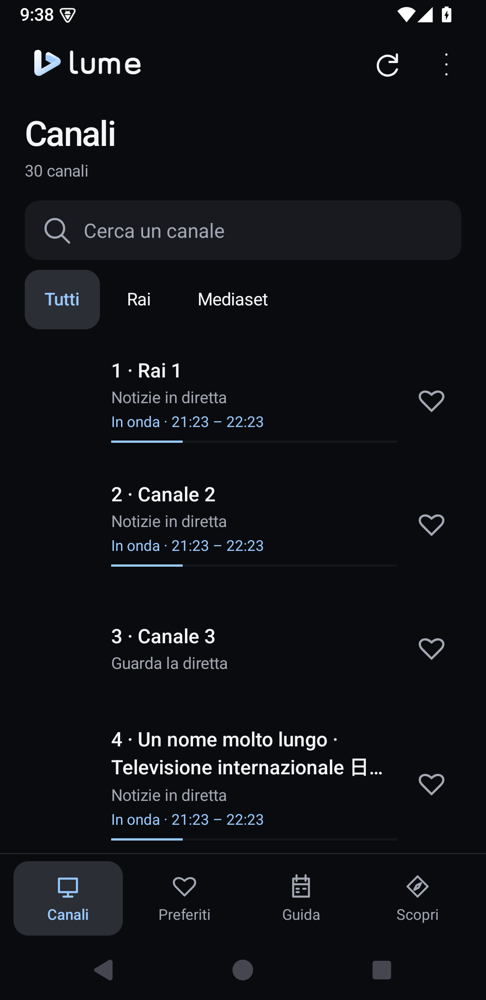
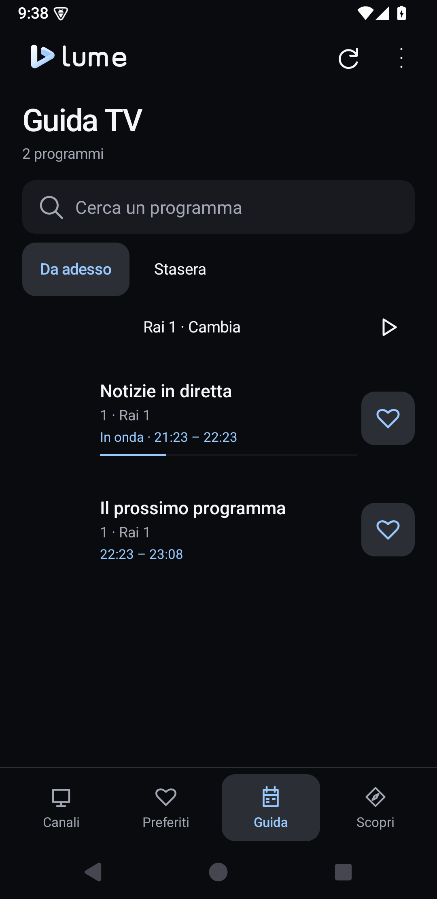
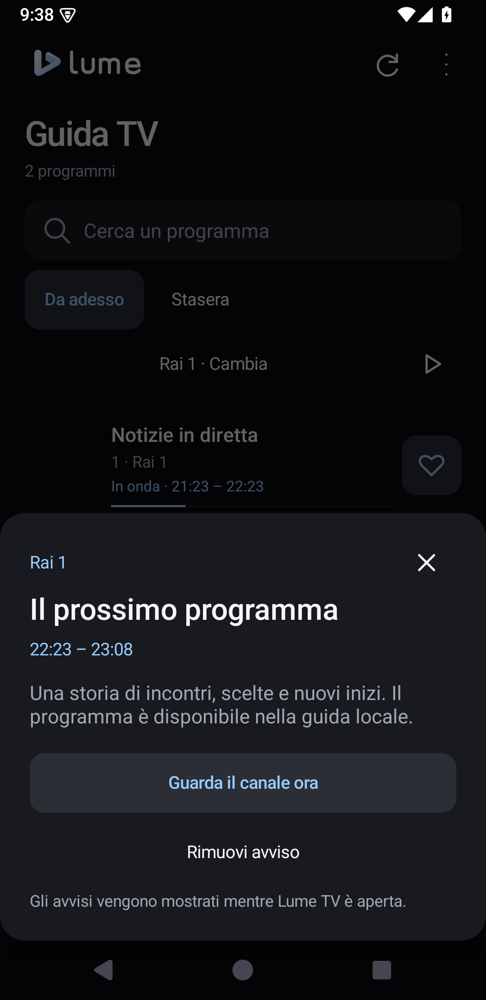
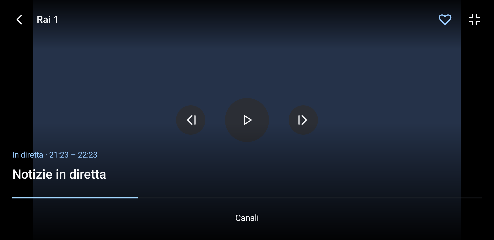

# Guida Lume TV per smartphone Android

Lume TV permette di guardare le dirette italiane sul telefono, con comandi touch, preferiti e palinsesto. La stessa APK comprende anche l’interfaccia per telecomando: se usi una TV, consulta la [guida per Android TV e Google TV](GUIDA-ANDROID-TV.md).

Questa guida descrive **Lume TV 0.7.0**, con radio in background, mini player, Picture in Picture e pagina Opzioni. La stessa APK supporta anche Android TV e Google TV; le versioni fino alla 0.5.3 comprendono soltanto la UI TV.

[Tutte le guide](GUIDA-UTENTE.md) · [Torna al progetto](../README.md) · [Novità](../CHANGELOG.md)

Le schermate di questa guida provengono dall’app nativa su emulatore Android e mostrano un palinsesto di prova.

## In questa guida

- [Installazione e primo avvio](#installazione-e-primo-avvio)
- [Scegliere l’interfaccia](#scegliere-linterfaccia)
- [Navigare tra le sezioni](#navigare-tra-le-sezioni)
- [Cercare e guardare un canale](#cercare-e-guardare-un-canale)
- [Salvare i preferiti](#salvare-i-preferiti)
- [Consultare la Guida](#consultare-la-guida)
- [Scoprire cosa guardare](#scoprire-cosa-guardare)
- [Impostare un avviso](#impostare-un-avviso)
- [Usare i controlli della diretta](#usare-i-controlli-della-diretta)
- [Cambiare canale durante la visione](#cambiare-canale-durante-la-visione)
- [Aggiornare catalogo, guida e applicazione](#aggiornare-catalogo-guida-e-applicazione)
- [Tornare indietro e uscire](#tornare-indietro-e-uscire)
- [Se qualcosa non funziona](#se-qualcosa-non-funziona)
- [Dati e collegamento con AURA](#dati-e-collegamento-con-aura)

## Installazione e primo avvio

Serve uno **smartphone con Android 6.0 o successivo**, collegato a Internet, e un’APK che includa il supporto smartphone.

1. Scarica [LumeTV-0.6.0.apk](https://github.com/pjor94/LumeTV/releases/download/v0.6.0/LumeTV-0.6.0.apk), oppure compila il [codice corrente](../README.md#compilazione). La build debug si trova in `app/build/outputs/apk/debug/app-debug.apk`.
2. Trasferisci il file sul telefono e aprilo dal gestore file. Se Android lo richiede, autorizza quel programma a installare applicazioni.
3. Conferma l’installazione e apri **Lume TV**.
4. Nella sezione **Canali**, tocca il nome del canale che vuoi guardare.

All’avvio normale, l’interfaccia smartphone apre il catalogo. La lista iniziale è inclusa nell’APK; catalogo, guida e loghi si aggiornano quando la connessione è disponibile. Lume non richiede un account.

Se Android segnala una firma incompatibile con l’app già installata, leggi [Se qualcosa non funziona](#se-qualcosa-non-funziona) prima di disinstallarla: la disinstallazione cancella i dati locali.

## Scegliere l’interfaccia

Il telefono viene riconosciuto automaticamente. Per cambiare modalità, apri **Opzioni**, il pulsante con i tre punti in alto a destra, poi **Interfaccia**:

- **Automatica:** sceglie la UI smartphone sui telefoni Android e quella TV su Android TV, Google TV, tablet e altri dispositivi.
- **Smartphone:** usa sempre i comandi touch descritti in questa guida.
- **TV:** usa la UI per telecomando descritta nella [guida TV](GUIDA-ANDROID-TV.md).

La scelta viene conservata. Su un tablet che si apre in modalità TV, scegli **Smartphone** per usare la navigazione touch. Cambiare modalità conserva catalogo, guida e preferiti sullo stesso dispositivo.

## Navigare tra le sezioni

La barra in basso contiene cinque sezioni:

| Sezione | Cosa puoi fare |
| --- | --- |
| **Canali** | Sfogliare il catalogo, cercare un canale e aprire la diretta |
| **Radio** | Cercare una stazione per nome o città, ascoltarla e ritrovare preferite e recenti |
| **Preferiti** | Ritrovare i canali che hai salvato con il cuore |
| **Guida** | Consultare il palinsesto di un canale alla volta |
| **Scopri** | Cercare tra i programmi in onda, in arrivo o della serata |

In alto trovi il pulsante di aggiornamento, con la freccia circolare, e **Opzioni**. La pagina comprende interfaccia, cambio canale, qualità e consumo dati, aggiornamenti, collegamento con AURA, informazioni e licenze.

## Cercare e guardare un canale

In **Canali**, ogni riga mostra il numero, il nome, il logo quando disponibile e il programma in onda, quando presente nel palinsesto.

- Scorri l’elenco e tocca una riga per aprire la diretta.
- Scrivi il nome o il numero del canale in **Cerca un canale**. I risultati si aggiornano mentre scrivi.
- Usa **Tutti**, **Rai** e **Mediaset** per filtrare il catalogo.
- Tocca il cuore accanto al nome per aggiungere o rimuovere un preferito.

I canali senza palinsesto restano guardabili. La disponibilità delle dirette dipende dalle emittenti, dalla rete e dai diritti territoriali.

## Salvare i preferiti

Tocca il cuore accanto a un canale: il pulsante evidenziato indica che è tra i preferiti. Apri **Preferiti** dalla barra inferiore per vedere l’elenco salvato; puoi filtrarlo e cercare un canale come nel catalogo.

Per rimuovere un preferito, tocca di nuovo il cuore. Puoi gestire i preferiti anche dai programmi della Guida e di Scopri, dai controlli della diretta e dall’elenco canali aperto durante la visione.

## Consultare la Guida

Apri **Guida** dalla barra inferiore. Il palinsesto viene mostrato per un canale alla volta.

1. Tocca il nome del canale seguito da **Cambia** e scegli il canale da consultare.
2. Usa **Da adesso** o **Stasera** per scegliere la fascia.
3. Scorri i programmi oppure usa **Cerca un programma**. La ricerca riguarda il canale selezionato.
4. Tocca un programma per leggere titolo, orari e descrizione, quando disponibile.
5. Scegli **Guarda il canale ora** per aprire la diretta attuale. Per i programmi futuri puoi anche [impostare un avviso](#impostare-un-avviso).

Il pulsante di riproduzione accanto al selettore del canale apre direttamente la diretta. Se manca il palinsesto, l’azione **Guarda [nome del canale]** permette comunque di guardarlo.

## Scoprire cosa guardare

Apri **Scopri**. Il titolo della schermata è **Cosa guardare** e i filtri disponibili sono:

- **Ora:** i programmi in onda, con i canali preferiti prima degli altri.
- **Tra poco:** il prossimo programma di ogni canale che inizia entro 90 minuti.
- **Stasera:** fino a due programmi per canale nella fascia 20:30–24:00 di oggi, secondo il fuso del dispositivo.
- **Solo preferiti:** restringe i risultati ai canali che hai salvato. Se il filtro non è visibile, scorri la riga dei filtri in orizzontale.

La ricerca considera titoli, descrizioni e nomi dei canali della fascia selezionata. Tocca un risultato per leggere i dettagli, guardare il canale ora o impostare un avviso per un programma futuro.

## Impostare un avviso

1. Dalla **Guida** o da **Scopri**, apri i dettagli di un programma futuro.
2. Tocca **Avvisami prima dell’inizio**. Il pulsante diventa **Rimuovi avviso**.
3. Per annullarlo, riapri gli stessi dettagli e tocca **Rimuovi avviso**.

Lume mostra il promemoria circa due minuti prima, **mentre l’app è aperta**. Puoi scegliere **Guarda ora** o **Più tardi**; il canale non cambia automaticamente. Gli avvisi sono locali e non vengono mostrati come notifiche fuori dall’app.

## Usare i controlli della diretta

Tocca il video per mostrare o nascondere i comandi. Durante la riproduzione si nascondono automaticamente; in pausa restano visibili.

| Comando | Azione |
| --- | --- |
| Freccia indietro in alto | Torna al catalogo o alla consultazione da cui hai aperto il canale |
| Cuore in alto | Aggiunge o rimuove il canale dai preferiti |
| Schermo intero | Porta il video in orizzontale; lo stesso pulsante riporta in verticale |
| Pulsante centrale | Mette in pausa o riprende la diretta |
| Pulsanti ai lati di pausa/ripresa | Passano al canale precedente o successivo |
| Titolo del programma | Apre i dettagli del programma in onda, se disponibili |
| **Canali** | Apre l’elenco canali mantenendo la diretta in riproduzione |

Orari, avanzamento e descrizione dipendono dai dati disponibili nella guida. Passare tra verticale e schermo intero conserva il player e l’eventuale pausa.

## Cambiare canale durante la visione

Puoi usare i pulsanti precedente/successivo oppure toccare **Canali** e scegliere dall’elenco. Il pulsante di chiusura o **Indietro** richiude l’elenco lasciando il video in riproduzione.

Nell’elenco trovi i filtri **Tutti** e **Preferiti**, i programmi in onda e i cuori per gestire i preferiti.

Per limitare il cambio con i pulsanti precedente/successivo, apri **Opzioni → Cambio canale** e scegli **Solo preferiti**. **Tutti i canali** ripristina il comportamento iniziale. Il filtro dell’elenco durante la diretta resta indipendente da questa impostazione.

## Aggiornare catalogo, guida e applicazione

La freccia circolare in alto richiede un aggiornamento di **catalogo e guida**. Gli aggiornamenti automatici del catalogo avvengono ogni 24 ore; quelli della guida ogni sei ore, mentre usi l’app. In caso di errore vengono conservati i dati già scaricati.

Per aggiornare l’applicazione:

1. Apri **Opzioni → Aggiornamenti → Controlla ora**.
2. Se è disponibile una nuova versione compatibile, tocca **Scarica e aggiorna**.
3. Attendi il download e la verifica. Se richiesto, consenti a **Lume TV** di installare applicazioni.
4. Conferma nel programma di installazione Android e riapri Lume TV.

Il controllo automatico avviene all’avvio, se sono trascorsi almeno 30 minuti dall’ultimo controllo riuscito, e ogni 30 minuti mentre usi l’app. Se trova una nuova versione compatibile, mostra un popup nel catalogo: **Aggiorna** apre la schermata Aggiornamenti; **Più tardi** o Indietro rinviano l’avviso al prossimo avvio. Durante una diretta il popup attende il ritorno al catalogo. Il pulsante di aggiornamento nel catalogo resta disponibile anche dopo il rinvio.

Puoi disattivare i controlli automatici nella stessa schermata. In caso di errore l’app attende un’ora, o più a lungo se GitHub richiede una pausa. Gli aggiornamenti con la stessa firma conservano preferiti e impostazioni. Per la disponibilità delle APK con supporto smartphone, consulta [Versioni e download](GUIDA-UTENTE.md#versioni-e-download).

## Tornare indietro e uscire

Il pulsante o il gesto **Indietro** di Android segue la schermata aperta:

| Dove sei | Cosa succede |
| --- | --- |
| Dettagli o elenco canali aperti | Chiude il pannello |
| Opzioni | Torna al catalogo precedente |
| Diretta | Torna alla consultazione precedente con il mini player |
| Ricerca | Chiude prima la tastiera o la ricerca |
| Radio, Preferiti, Guida o Scopri | Torna a Canali |
| Home di Canali | Chiude la schermata dell’app senza conferma |

Le radio e la TV in modalità **Solo audio** continuano anche lasciando l’app o bloccando lo schermo. La TV video può proseguire in **Picture in Picture**, quando disponibile e consentito; senza PiP la riproduzione video si interrompe uscendo. Per terminare l’ascolto usa **Interrompi** nel player, nel mini player o nei controlli di sistema. Preferiti e impostazioni rimangono salvati.

## Se qualcosa non funziona

**Vedo l’interfaccia TV sul telefono.** Apri **Opzioni → Interfaccia → Smartphone**. La scelta rimane salvata. Se la voce Interfaccia non compare, verifica la versione: la UI smartphone è disponibile dalla 0.6.0; le versioni fino alla 0.5.3 includono soltanto quella TV.

**Il canale non ha programmi o descrizione.** Non tutti i canali hanno un palinsesto disponibile. Tocca la freccia di aggiornamento; puoi comunque aprire il canale dalla sezione Canali o dall’azione Guarda della Guida.

**Un canale si interrompe.** Lume prova a recuperare le interruzioni temporanee e attende il ritorno della connessione quando manca la rete. Se compare un errore, usa **Riprova** o scegli un altro canale da **Canali**.

**I pulsanti precedente/successivo non scorrono tutti i canali.** Controlla **Opzioni → Cambio canale**: potrebbe essere selezionato **Solo preferiti**.

**Android rifiuta l’installazione o un aggiornamento.** Le APK di sviluppo e le release ufficiali possono avere firme diverse. Android può richiedere di disinstallare la versione precedente; questa operazione cancella preferiti e impostazioni locali.

**Vuoi segnalare un problema.** Apri una [segnalazione su GitHub](https://github.com/pjor94/LumeTV/issues) indicando canale, modello del telefono, versione Android e versione di Lume TV, visibile in **Opzioni → Informazioni**. Non pubblicare credenziali o token.

## Dati e collegamento con AURA

Catalogo, guida, preferiti e impostazioni sono conservati sul dispositivo. Ogni telefono e ogni TV mantiene i propri dati locali. Lume non richiede un account e non contiene telemetria; consulta la [privacy nel README](../README.md#privacy).

Il collegamento con AURA è facoltativo e riguarda i metadati sullo stesso dispositivo. Si abilita o si revoca in **Opzioni → Collegamento con AURA**. I dettagli sono nel [contratto di integrazione](integration-aura.md).

---

Lume TV è un progetto indipendente basato sul lavoro di WorldLiveTV / WLTV Group; non è un’app ufficiale delle emittenti. Le prove della UI smartphone sono state eseguite su emulatore, con palinsesto e video locali.

## Radio e multitasking

Queste funzioni sono disponibili dalla versione 0.7.0.

**Radio** apre il catalogo italiano WLTV. Cerca il nome di una stazione o di una città, oppure usa **Tutte / Preferite / Recenti**. Il cuore salva la stazione; i recenti comprendono le emittenti avviate correttamente. Il cambio precedente/successivo rimane tra le radio; durante la TV rimane tra i canali TV.

La schermata di ascolto mostra stazione, stato e titolo del brano quando fornito dal flusso. Puoi usare pausa/ripresa, precedente/successivo, preferito e **Interrompi**. Tornando al catalogo, il mini player continua a riprodurre e permette di riaprire il player o interrompere. Le radio continuano anche passando ad altre app e bloccando lo schermo; i controlli di sistema e delle cuffie agiscono sulla stessa riproduzione. Chiamate, altre app audio e scollegamento delle cuffie vengono gestiti dal sistema audio Android.

Durante una diretta TV, il pulsante **Picture in Picture** apre la finestra video sui dispositivi compatibili con Android 8 o successivo. Durante la riproduzione il passaggio alla Home può aprirla automaticamente, se consentito dalle impostazioni Android. Chiudendo il PiP la TV si interrompe. Il pulsante **Solo audio** mantiene invece il suono a schermo spento; **Torna al video** ripristina l’immagine. Un flusso che unisce audio e video può continuare a richiedere il traffico di entrambe le tracce anche in modalità solo audio.

**Opzioni → Qualità e consumo dati → Automatica / Risparmio dati** modifica la selezione delle qualità disponibili. Le radio con un solo bitrate mantengono quello dell’emittente. L’audio offload viene abilitato quando il dispositivo e il formato lo consentono; i consumi reali richiedono una prova sul telefono fisico.

**Opzioni** apre una pagina dedicata con le preferenze di riproduzione e le voci dell’app. Sotto ogni voce compare il valore attuale. La freccia in alto e Indietro di Android riportano al catalogo conservando sezione, ricerca e posizione. Durante l’ascolto o la visione, il mini player resta disponibile nella pagina: puoi mettere in pausa, interrompere o riaprire il player.

Non sono previsti timer di spegnimento né integrazioni per l’auto in questa versione.
