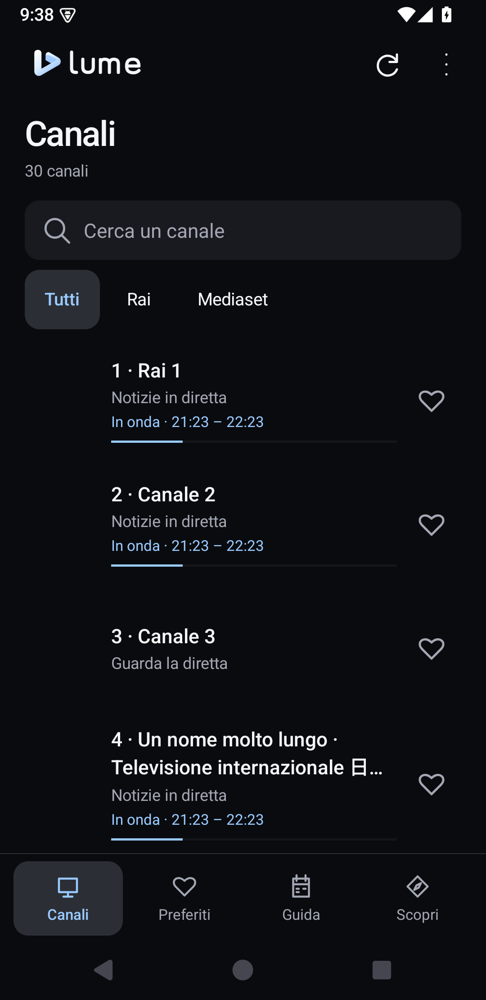
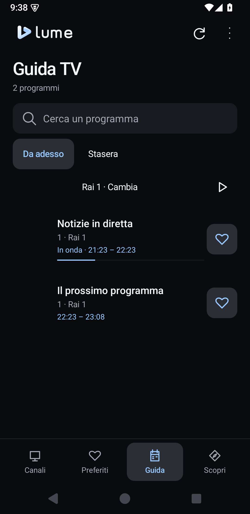
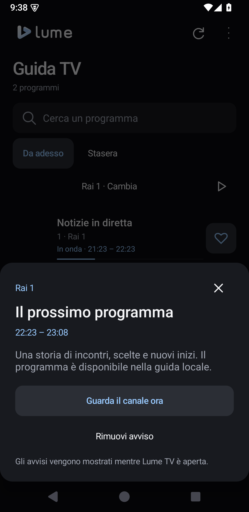
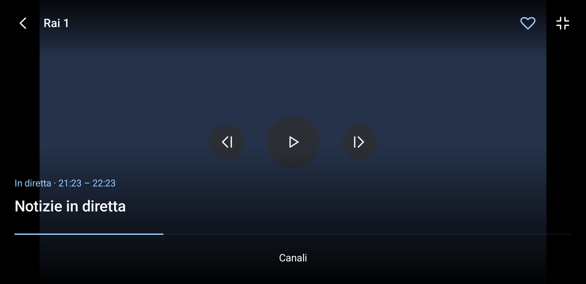

# Guida Lume TV per smartphone Android

Lume TV permette di guardare le dirette italiane sul telefono, con comandi touch, preferiti e palinsesto. La stessa APK comprende anche l’interfaccia per telecomando: se usi una TV, consulta la [guida per Android TV e Google TV](GUIDA-ANDROID-TV.md).

Questa guida descrive **Lume TV 0.12.1**, con liste personali, radio in background, mini player, Picture in Picture e pagina Opzioni. La stessa APK supporta anche Android TV e Google TV. Le versioni fino alla 0.5.3 comprendono soltanto la UI TV.

La funzione **Canali nella Home**, dalla versione 0.8.0, compare nelle Opzioni soltanto sui dispositivi TV, anche quando si usa l’interfaccia Smartphone. Sui telefoni non pubblica canali. Vedi la [guida per Android TV](GUIDA-ANDROID-TV.md#canali-nella-home).

[Tutte le guide](GUIDA-UTENTE.md) · [Torna al progetto](../README.md) · [Novità](../CHANGELOG.md)

Le schermate di questa guida provengono dall’app nativa su emulatore Android e mostrano un palinsesto di prova.

## Telecomando e collegamento TV

Sulla TV apri **Opzioni → Collega telefono**: il QR grande compare automaticamente sulla destra. Sullo smartphone tocca l’icona **Telecomando** in alto. Al primo collegamento si apre la fotocamera; inquadra il QR per collegarti subito, senza altre conferme sulla TV. Il telecomando si apre sul telefono e la TV torna automaticamente alla schermata precedente. Il permesso per la fotocamera viene richiesto soltanto per la scansione.

Dalle volte successive **Telecomando** riconnette l’ultima TV usata. Tocca il nome della TV nell’intestazione per cambiarla, scansionare un altro QR o rimuovere un collegamento salvato tenendo premuto il nome nell’elenco. Se annulli la scansione, puoi riprovare dalla stessa pagina.

**Altri metodi** raccoglie l’abbinamento tramite codice di 16 caratteri e l’inserimento di IP e porta. Sulla TV apri **Opzioni → Collega telefono → Altri metodi** per leggerli; con il codice manuale conferma ancora **Consenti** sulla TV. Cambiare metodo invalida l’invito precedente. Il QR è monouso, scade dopo due minuti e si rinnova automaticamente mentre la pagina è aperta: chi lo inquadra può controllare Lume sulla TV. La revoca mostra **Abbina di nuovo** sul telefono.

Il telecomando indica sempre quale TV controlli. La **croce direzionale con OK centrale** muove il focus e apre la voce selezionata nell’interfaccia TV, anche senza una riproduzione attiva. **Indietro** torna alla schermata precedente sulla TV; il pulsante Indietro nell’intestazione del telefono chiude invece il telecomando. **Home** apre il catalogo di Lume e **Opzioni** apre le impostazioni sulla TV. Nelle finestre di scelta sulla TV puoi usare frecce, OK e Indietro; chiudi la finestra prima di premere Home o Opzioni. La conferma del codice manuale e la rimozione dei telefoni richiedono il telecomando fisico della TV.

Sotto la navigazione trovi **Pausa / Riprendi**, cambio canale nelle dirette e **−10 s / +30 s** nei video. **Opzioni riproduzione** raccoglie audio, sottotitoli, qualità, timer e interruzione in una sezione espandibile. In orizzontale navigazione e riproduzione si affiancano. I comandi non disponibili restano disabilitati. La TV riproduce autonomamente e continua se chiudi questa pagina o spegni lo schermo del telefono.

La modifica delle liste e delle impostazioni già presenti sulla TV tramite moduli sul telefono non è ancora disponibile. Puoi navigare le impostazioni mostrate sullo schermo TV; le modifiche alle impostazioni locali del telefono non si applicano alla TV. Il controllo resta dentro Lume, senza aprire la Home Android o altre applicazioni.

Le TV autorizzate vengono ricordate e il collegamento riprende quando Lume torna disponibile. Per revocare l’autorizzazione usa **Opzioni → Collega telefono → Gestisci collegamenti** sulla TV. Non vengono trasferiti automaticamente cataloghi, liste, preferiti o avanzamenti.

### Inviare una lista alla TV

1. Nel **Telecomando**, scorri fino a **Invia lista alla TV**. Il nome in alto indica la TV di destinazione.
2. Scegli una lista già salvata sul telefono da **Opzioni → Le mie liste**. Sono supportate sia le liste da URL sia quelle importate da file, anche se disattivate sul telefono.
3. Attendi l’invio e la verifica sulla TV. Il telefono mostra il numero di voci e alcuni titoli di esempio; puoi modificare il **Nome sulla TV**.
4. Premi **Importa sulla TV**. Al termine la lista compare in **Le mie liste** sulla TV, con nuovi identificativi locali. Un nome già presente richiede di sceglierne un altro.

Vengono trasferiti le voci attive e i loro metadati, l’eventuale indirizzo di aggiornamento e le impostazioni di accesso e della guida. Preferiti, avanzamenti e associazioni manuali dei canali XMLTV restano sul dispositivo originale. La lista importata sulla TV è una copia indipendente e abilitata; la riproduzione in corso prosegue.

**Annulla** prima della conferma elimina l’invio senza aggiungere liste. Dopo la conferma, **Chiudi** lascia proseguire l’importazione sulla TV. Se il collegamento si interrompe, **Riprova** riprende i blocchi già ricevuti quando ancora disponibili; **Verifica esito** controlla una conferma già inviata. Mantieni Lume aperta sulla TV e i dispositivi sulla stessa rete privata. Se la TV usa una versione precedente, aggiorna Lume per abilitare l’invio.

Serve una rete privata IPv4 che consenta ai dispositivi di comunicare; la TV può usare Ethernet. Le reti ospiti con isolamento dei dispositivi possono impedire il collegamento anche tramite QR. Lume deve essere aperta sulla TV: questa funzione non accende il televisore e non avvia l’app chiusa. Disponibile dalla versione 0.11.0.

### Guardare sulla TV

1. Nel player tocca l’icona **Guarda sulla TV**, oppure usa il pulsante nelle schede Video e nei dettagli dei programmi.
2. Viene proposta l’ultima TV abbinata. **Cambia TV** permette di sceglierne un’altra o di collegarla con il QR.
3. Attendi la verifica del contenuto e controlla il nome della TV e il titolo trovato. Premi **Guarda sulla TV** per avviare la riproduzione.
4. Quando la TV conferma che sta riproducendo, il telefono interrompe il proprio player e apre il telecomando.

Per i video viene usato il punto corrente del player del telefono, oppure l’avanzamento locale se scegli dalla scheda del titolo. Nelle schede delle serie viene proposto l’episodio da riprendere o il primo non visto. L’avanzamento già presente sulla TV non sostituisce quello inviato.

La funzione usa i canali integrati e le liste già disponibili sui due dispositivi. Per una lista importata da file, usa la stessa copia su telefono e TV; puoi prepararla con **Invia lista alla TV**. Se la verifica non trova una corrispondenza univoca, la schermata spiega come procedere e il telefono continua a riprodurre. **Verifica avvio** controlla l’esito di una conferma già inviata dopo un’interruzione della rete. Mantieni Lume aperta sulla TV durante il passaggio.

## In questa guida

- [Telecomando e collegamento TV](#telecomando-e-collegamento-tv)
- [Liste personali](#liste-personali)
- [Video on demand](#video-on-demand)
- [Backup e ripristino](#backup-e-ripristino)
- [Installazione e primo avvio](#installazione-e-primo-avvio)
- [Scegliere l’interfaccia](#scegliere-linterfaccia)
- [Navigare tra le sezioni](#navigare-tra-le-sezioni)
- [Cercare e guardare un canale](#cercare-e-guardare-un-canale)
- [Salvare i preferiti](#salvare-i-preferiti)
- [Consultare la Guida](#consultare-la-guida)
- [Scoprire cosa guardare](#scoprire-cosa-guardare)
- [Impostare un avviso](#impostare-un-avviso)
- [Usare i controlli della diretta](#usare-i-controlli-della-diretta)
- [Cambiare canale durante la visione](#cambiare-canale-durante-la-visione)
- [Aggiornare catalogo, guida e applicazione](#aggiornare-catalogo-guida-e-applicazione)
- [Tornare indietro e uscire](#tornare-indietro-e-uscire)
- [Se qualcosa non funziona](#se-qualcosa-non-funziona)
- [Dati e collegamento con AURA](#dati-e-collegamento-con-aura)

## Liste personali

Apri **Opzioni → Le mie liste → Aggiungi URL** e assegna un nome alla sorgente. Sono accettati indirizzi HTTPS e, selezionando **Consenti HTTP per questa lista**, anche HTTP. **Importa file** usa il selettore documenti Android, quando disponibile. Scegli TV o radio come tipo predefinito per le voci che non lo indicano.

**Verifica lista** mostra avanzamento e anteprima con voci importabili, escluse e duplicate; **Interrompi verifica** conserva i dati inseriti. Conferma con **Importa lista** o **Sostituisci lista**. I file sono copiati nell’archivio privato: spostare l’originale non rende indisponibili i canali.

La gestione usa pagine nello stile di **Opzioni**, con salvataggio esplicito ed errori e conferme nella pagina. **Sorgente** modifica nome, attivazione, consenso HTTP e URL/file. **Lettura e contenuti** contiene formato, codifica, gruppi e aggiornamento; **Accesso ai server** contiene header, server autorizzati, cookie e HTTP dei loghi. **Stato e ultima importazione** riporta metadati e motivi degli scarti. **Indietro** conserva i campi tornando dalle sottosezioni e propone di continuare o scartare eventuali modifiche non salvate.

Nel catalogo, **Lista** seleziona la sorgente e **Tutti i gruppi** restringe l’elenco. Preferiti e cambio canale mantengono la distinzione tra TV, radio e sorgenti. Gli aggiornamenti conservano la riproduzione e l’ultima copia valida. Disattivare conserva i dati; eliminare rimuove anche preferiti, guida e avanzamenti associati e interrompe la relativa riproduzione.

Limiti: **10 liste, 500.000 voci lette per sorgente, un milione di voci importate complessive e 256 MiB per documento**. Il catalogo scorre in continuo; ricerca e gruppi considerano l’intera lista. Sono disponibili M3U semplice o estesa, UTF-8/Windows-1252/Latin-1, liste incluse e le forme di header, KODIPROP e ClearKey DASH/CENC documentate. HTTP invia senza cifratura indirizzi e dati di accesso; i consensi di lista, loghi e guida restano separati.

**Guida e archivio** configura gli indirizzi XMLTV, gli orari, le associazioni dei canali e l’archivio. Se mancano indirizzi XMLTV della lista, Lume usa la propria guida per i canali riconosciuti, cercando nell’intera sorgente EPG anche oltre il catalogo integrato. I loghi mancanti vengono completati dai dati Lume; guida e loghi forniti dalla lista mantengono la precedenza. Le esclusioni manuali e la guida disattivata restano rispettate. EPGShare IT1 completa i canali ancora senza palinsesto Lume e i loghi ancora mancanti; i programmi supplementari indicano la fonte nei dettagli. La guida personale supporta XML/gzip/xz, ricerca e storico fino a sette giorni. La voce **Video** nella barra principale compare solo con VOD in almeno una lista abilitata e apre la biblioteca con copertine, Film, Serie, ricerca e scorrimento continuo; il player conserva la posizione. Dalla guida puoi scegliere **Rivedi dall’archivio** o **Guarda dall’inizio**, quando il servizio li supporta; **Torna alla diretta** lascia il replay. Questa funzione non registra i programmi sul dispositivo.

Gli archivi della 0.8.0 vengono migrati conservando ID, preferiti e impostazioni. Liste, guida personale e avanzamenti restano locali ed esclusi da AURA e dalla Home dei launcher. [Formati, limiti e funzionamento](personal-playlists.md).

L’apertura del selettore documenti segue le normali regole di riproduzione in background del telefono.

## Video on demand

Durante la riproduzione i controlli scompaiono dopo circa cinque secondi. Tocca il video per mostrarli o nasconderli; in pausa rimangono disponibili. La barra distingue avanzamento, video già caricato e parte ancora da caricare.

Trascina la barra per cercare una scena: vedi il tempo selezionato e, quando disponibile, un fotogramma. Rilascia per confermare il salto; **Indietro** annulla la ricerca in corso. Il primo **Indietro** fuori dalla ricerca chiude i controlli e il successivo torna al catalogo. I comandi usano icone per play/pausa e salti di 10/30 secondi; l’ingranaggio apre **Audio e opzioni**, con tracce, sottotitoli, qualità e timer. I tre puntini di **Altro** raccolgono **Dall’inizio**, **Solo audio** e **Capitoli**, quando la lista fornisce un indice. Le icone mantengono i nomi per i lettori dello schermo.

Il VOD usa una riserva di riproduzione e una cache locale temporanea con quota automatica. I dati video vengono eliminati al cambio di contenuto, alla fine o interruzione definitiva del video e alla chiusura dell’app. Pausa, ricerca delle scene e riconnessione dello stesso contenuto mantengono la cache; il mini player mantiene la sessione finché il video continua. Chiudendo l’app dalle attività recenti si interrompe anche il VOD in modalità Solo audio. Dopo una chiusura forzata, eventuali residui vengono rimossi al successivo avvio. Il caricamento anticipato dà precedenza al video che stai guardando; durata della riserva e disponibilità delle anteprime dipendono dalla sorgente e dal dispositivo. Non equivale a un download offline del film.

**Dalla versione 0.11.0:** nelle schede di film ed episodi trovi **Segna come visto / Segna come non visto**. Non visto azzera la ripresa; un titolo visto propone **Riguarda**. Le scelte restano salvate anche se il vecchio player è ancora aperto.

**Rimuovi da Continua a guardare** nasconde il titolo da quella raccolta conservando il punto raggiunto. Dalla scheda puoi scegliere **Mostra in Continua a guardare**; avviare nuovamente la riproduzione lo rende visibile. Un tentativo non riuscito mantiene lo stato precedente. La mia lista rimane indipendente da questi comandi.

Per le serie, **Episodio successivo** raggiunge il successivo della stessa sorgente. A fine riproduzione compare **Guarda il prossimo episodio**: toccalo per avviarlo. Non parte automaticamente e il timer di arresto continua a scorrere. Aprendo la scheda di una serie si riprende l’episodio in corso o si propone il primo non visto. Disponibili dalla versione 0.11.0.

Se almeno una lista abilitata contiene video, nella barra principale compare **Video**, tra **Canali** e **Radio**. La home mostra copertine e raccolte Film, Serie, Continua a guardare e La mia lista. **Mostra tutto** apre la raccolta completa; **Cerca** e **Filtri** permettono di restringere i risultati per titolo, lista, categoria e ordine.

Seleziona una copertina per aprire la scheda del titolo. **Guarda** o **Riprendi** avvia il player; **Dall’inizio** riparte da zero. Le serie riconosciute raggruppano stagioni ed episodi. Tornando dal player o passando tra le sezioni si conservano pagina e posizione. Copertine e informazioni dipendono dai dati presenti nella lista.

La home Video non mostra la freccia Indietro: cambia sezione dalla barra inferiore. Nelle raccolte e nelle schede la freccia torna al livello precedente. In orizzontale la barra si compatta e mantiene le icone.

## Backup e ripristino

Disponibile dalla versione 0.11.0.

Apri **Opzioni → Backup e ripristino → Crea backup**. Inserisci due volte una password da 8 a 128 caratteri e tocca **Crea e scegli dove salvare**. Scegli la cartella dal selettore documenti Android: il file `.lumebackup` contiene anche le configurazioni di accesso delle liste ed è protetto dalla password. Conservala per poterlo riaprire.

Per recuperare i dati, scegli **Ripristina backup**, seleziona il file, inserisci la password e tocca **Verifica backup**. L’anteprima permette di scegliere singole liste e categorie prima di confermare **Ripristina dati selezionati**.

- Le liste mancanti vengono aggiunte; quelle già presenti conservano contenuti e impostazioni. Nomi uguali vengono distinti.
- Preferiti, La mia lista e nascosti vengono uniti mantenendo l’ordine dei preferiti attuale.
- Gli avanzamenti già presenti hanno la precedenza, compresi Visto/Non visto e visibilità in Continua a guardare.
- La categoria **Preferenze di riproduzione** applica audio, sottotitoli, qualità e cambio canale del backup; deselezionala per mantenere le preferenze attuali.

I dati di liste escluse possono essere ignorati se non trovano la stessa lista sul dispositivo. Scelta dell’interfaccia, consenso AURA e pubblicazione nella Home restano propri del dispositivo. Il file non include video o immagini dei contenuti.

Sono necessari un gestore documenti compatibile e spazio temporaneo per la verifica. Password errata o file danneggiato mostrano un errore nella pagina e permettono di riprovare.

## Installazione e primo avvio

Serve uno **smartphone con Android 6.0 o successivo**, collegato a Internet, e un’APK che includa il supporto smartphone.

1. Scarica [LumeTV-0.12.1.apk](https://github.com/pjor94/LumeTV/releases/download/v0.12.1/LumeTV-0.12.1.apk), oppure compila il [codice corrente](../README.md#compilazione). La build debug si trova in `app/build/outputs/apk/debug/app-debug.apk`.
2. Trasferisci il file sul telefono e aprilo dal gestore file. Se Android lo richiede, autorizza quel programma a installare applicazioni.
3. Conferma l’installazione e apri **Lume TV**.
4. Nella sezione **Canali**, tocca il nome del canale che vuoi guardare.

All’avvio normale, l’interfaccia smartphone apre il catalogo. La lista iniziale è inclusa nell’APK; catalogo, guida e loghi si aggiornano quando la connessione è disponibile. Lume non richiede un account.

Se Android segnala una firma incompatibile con l’app già installata, leggi [Se qualcosa non funziona](#se-qualcosa-non-funziona) prima di disinstallarla: la disinstallazione cancella i dati locali.

## Scegliere l’interfaccia

Il telefono viene riconosciuto automaticamente. Per cambiare modalità, apri **Opzioni**, il pulsante con i tre punti in alto a destra, poi **Interfaccia**:

- **Automatica:** sceglie la UI smartphone sui telefoni Android e quella TV su Android TV, Google TV, tablet e altri dispositivi.
- **Smartphone:** usa sempre i comandi touch descritti in questa guida.
- **TV:** usa la UI per telecomando descritta nella [guida TV](GUIDA-ANDROID-TV.md).

La scelta viene conservata. Su un tablet che si apre in modalità TV, scegli **Smartphone** per usare la navigazione touch. Cambiare modalità conserva catalogo, guida e preferiti sullo stesso dispositivo.

## Navigare tra le sezioni

Dalla versione 0.11.0 la barra contiene al massimo cinque sezioni: **Canali / Video / Radio / Guida / Scopri**, con Video solo quando disponibile. I filtri **Tutti / Preferiti / Recenti** sono accessibili dentro Canali e Radio. Il collegamento `lumetv://favorites` apre direttamente il filtro Preferiti.

**Video** compare tra Canali e Radio solo se almeno una lista abilitata contiene VOD:

| Sezione | Cosa puoi fare |
| --- | --- |
| **Canali** | Sfogliare il catalogo, cercare un canale e aprire la diretta |
| **Video** | Consultare film, serie e altri video delle liste abilitate |
| **Radio** | Cercare una stazione per nome o città, ascoltarla e ritrovare preferite e recenti |
| **Guida** | Consultare il palinsesto di un canale alla volta |
| **Scopri** | Cercare tra i programmi in onda, in arrivo o della serata |

In alto trovi **Telecomando**, il pulsante di aggiornamento con la freccia circolare e **Opzioni**. La pagina comprende interfaccia, cambio canale, qualità e consumo dati, aggiornamenti, collegamento con AURA, informazioni e licenze.

## Cercare e guardare un canale

In **Canali**, ogni riga mostra il numero, il nome, il logo quando disponibile e il programma in onda, quando presente nel palinsesto.

- Scorri l’elenco e tocca una riga per aprire la diretta.
- Scrivi il nome o il numero del canale in **Cerca un canale**. I risultati si aggiornano mentre scrivi.
- Usa **Tutti**, **Rai** e **Mediaset** per filtrare il catalogo.
- Tocca il cuore accanto al nome per aggiungere o rimuovere un preferito.

I canali senza palinsesto restano guardabili. La disponibilità delle dirette dipende dalle emittenti, dalla rete e dai diritti territoriali.

## Salvare i preferiti

**Dalla versione 0.11.0:** apri il filtro **Preferiti** dentro Canali o Radio. Il pulsante accanto ai filtri, oppure **Opzioni → Canali e preferiti**, apre la gestione. Trascina la maniglia per cambiare l’ordine; in alternativa tocca un canale, scegli **Sposta**, usa **Su / Giù** e premi **Salva**. **Indietro** annulla lo spostamento non salvato. Numeri originali e titoli salvati in Video restano conservati.

Nella gestione puoi scegliere **Nascondi canale**. Il canale sparisce dal catalogo, dalla guida, dalla ricerca e dal cambio canale; se è già in riproduzione, la diretta continua. Per mostrarlo di nuovo apri **Nascosti**, scegli il canale e premi **Ripristina canale**. Il cuore e la posizione vengono mantenuti, anche aggiornando o disattivando una lista. Eliminare la lista rimuove le personalizzazioni associate.

Tocca il cuore accanto a un canale: il pulsante evidenziato indica che è tra i preferiti. Apri **Preferiti** dalla barra inferiore per vedere l’elenco salvato; puoi filtrarlo e cercare un canale come nel catalogo.

Per rimuovere un preferito, tocca di nuovo il cuore. Puoi gestire i preferiti anche dai programmi della Guida e di Scopri, dai controlli della diretta e dall’elenco canali aperto durante la visione.

## Consultare la Guida

Apri **Guida** dalla barra inferiore. Il palinsesto viene mostrato per un canale alla volta.

1. Tocca il nome del canale seguito da **Cambia** e scegli il canale da consultare.
2. Usa **Da adesso** o **Stasera** per scegliere la fascia.
3. Scorri i programmi oppure usa **Cerca un programma**. La ricerca riguarda il canale selezionato.
4. Tocca un programma per leggere titolo, orari e descrizione, quando disponibile.
5. Scegli **Guarda il canale ora** per aprire la diretta attuale. Per i programmi futuri puoi anche [impostare un avviso](#impostare-un-avviso).

Il pulsante di riproduzione accanto al selettore del canale apre direttamente la diretta. Se manca il palinsesto, l’azione **Guarda [nome del canale]** permette comunque di guardarlo.

## Scoprire cosa guardare

Apri **Scopri**. Il titolo della schermata è **Cosa guardare** e i filtri disponibili sono:

- **Ora:** i programmi in onda, con i canali preferiti prima degli altri.
- **Tra poco:** il prossimo programma di ogni canale che inizia entro 90 minuti.
- **Stasera:** fino a due programmi per canale nella fascia 20:30–24:00 di oggi, secondo il fuso del dispositivo.
- **Solo preferiti:** restringe i risultati ai canali che hai salvato. Se il filtro non è visibile, scorri la riga dei filtri in orizzontale.

La ricerca considera titoli, descrizioni e nomi dei canali della fascia selezionata. Tocca un risultato per leggere i dettagli, guardare il canale ora o impostare un avviso per un programma futuro.

## Impostare un avviso

1. Dalla **Guida** o da **Scopri**, apri i dettagli di un programma futuro.
2. Tocca **Avvisami prima dell’inizio**. Il pulsante diventa **Rimuovi avviso**.
3. Per annullarlo, riapri gli stessi dettagli e tocca **Rimuovi avviso**.

Lume mostra il promemoria circa due minuti prima, **mentre l’app è aperta**. Puoi scegliere **Guarda ora** o **Più tardi**; il canale non cambia automaticamente. Gli avvisi sono locali e non vengono mostrati come notifiche fuori dall’app.

## Usare i controlli della diretta

Dalla versione 0.11.0, aprire un video o una diretta porta subito il player in orizzontale a schermo intero, anche con la rotazione automatica del telefono disattivata. Tornando al catalogo viene ripristinata la rotazione normale.

Tocca il video per mostrare o nascondere i comandi. Durante la riproduzione si nascondono automaticamente; in pausa restano visibili.

| Comando | Azione |
| --- | --- |
| Freccia indietro in alto | Torna al catalogo o alla consultazione da cui hai aperto il canale |
| Cuore in alto | Aggiunge o rimuove il canale dai preferiti |
| Schermo intero / Esci da schermo intero | Passa tra orizzontale a schermo intero e verticale |
| Pulsante centrale | Mette in pausa o riprende la diretta |
| Pulsanti ai lati di pausa/ripresa | Passano al canale precedente o successivo |
| Titolo del programma | Apre i dettagli del programma in onda, se disponibili |
| **Canali** | Apre l’elenco canali mantenendo la diretta in riproduzione |

Orari, avanzamento e descrizione dipendono dai dati disponibili nella guida. Passare tra verticale e schermo intero conserva il player e l’eventuale pausa.

## Cambiare canale durante la visione

Puoi usare i pulsanti precedente/successivo oppure toccare **Canali** e scegliere dall’elenco. Il pulsante di chiusura o **Indietro** richiude l’elenco lasciando il video in riproduzione.

Nell’elenco trovi i filtri **Tutti** e **Preferiti**, i programmi in onda e i cuori per gestire i preferiti.

Per limitare il cambio con i pulsanti precedente/successivo, apri **Opzioni → Cambio canale** e scegli **Solo preferiti**. **Tutti i canali** ripristina il comportamento iniziale. Il filtro dell’elenco durante la diretta resta indipendente da questa impostazione.

## Aggiornare catalogo, guida e applicazione

La freccia circolare in alto richiede un aggiornamento di **catalogo e guida**. Gli aggiornamenti automatici del catalogo avvengono ogni 24 ore; quelli della guida ogni sei ore, mentre usi l’app. In caso di errore vengono conservati i dati già scaricati.

Per aggiornare l’applicazione:

1. Apri **Opzioni → Aggiornamenti → Controlla ora**.
2. Se è disponibile una nuova versione compatibile, tocca **Scarica e aggiorna**.
3. Attendi il download e la verifica. Se richiesto, consenti a **Lume TV** di installare applicazioni.
4. Conferma nel programma di installazione Android e riapri Lume TV.

Il controllo automatico avviene all’avvio, se sono trascorsi almeno 30 minuti dall’ultimo controllo riuscito, e ogni 30 minuti mentre usi l’app. Se trova una nuova versione compatibile, mostra un popup nel catalogo: **Aggiorna** apre la schermata Aggiornamenti; **Più tardi** o Indietro rinviano l’avviso al prossimo avvio. Durante una diretta il popup attende il ritorno al catalogo. Il pulsante di aggiornamento nel catalogo resta disponibile anche dopo il rinvio.

Puoi disattivare i controlli automatici nella stessa schermata. In caso di errore l’app attende un’ora, o più a lungo se GitHub richiede una pausa. Gli aggiornamenti con la stessa firma conservano preferiti e impostazioni. Per la disponibilità delle APK con supporto smartphone, consulta [Versioni e download](GUIDA-UTENTE.md#versioni-e-download).

## Tornare indietro e uscire

Il pulsante o il gesto **Indietro** di Android segue la schermata aperta:

| Dove sei | Cosa succede |
| --- | --- |
| Dettagli o elenco canali aperti | Chiude il pannello |
| Opzioni | Torna al catalogo precedente |
| Diretta | Torna alla consultazione precedente con il mini player |
| Ricerca | Chiude prima la tastiera o la ricerca |
| Radio, Preferiti, Guida o Scopri | Torna a Canali |
| Home di Canali | Chiude la schermata dell’app senza conferma |

Le radio e la TV in modalità **Solo audio** continuano anche lasciando l’app o bloccando lo schermo. La TV video può proseguire in **Picture in Picture**, quando disponibile e consentito; senza PiP la riproduzione video si interrompe uscendo. Per terminare l’ascolto usa **Interrompi** nel player, nel mini player o nei controlli di sistema. Preferiti e impostazioni rimangono salvati.

## Se qualcosa non funziona

**Vedo l’interfaccia TV sul telefono.** Apri **Opzioni → Interfaccia → Smartphone**. La scelta rimane salvata. Se la voce Interfaccia non compare, verifica la versione: la UI smartphone è disponibile dalla 0.6.0; le versioni fino alla 0.5.3 includono soltanto quella TV.

**Il canale non ha programmi o descrizione.** Non tutti i canali hanno un palinsesto disponibile. Tocca la freccia di aggiornamento; puoi comunque aprire il canale dalla sezione Canali o dall’azione Guarda della Guida.

**Un canale si interrompe.** Lume prova a recuperare le interruzioni temporanee e attende il ritorno della connessione quando manca la rete. Se compare un errore, usa **Riprova** o scegli un altro canale da **Canali**.

**I pulsanti precedente/successivo non scorrono tutti i canali.** Controlla **Opzioni → Cambio canale**: potrebbe essere selezionato **Solo preferiti**.

**Android rifiuta l’installazione o un aggiornamento.** Le APK di sviluppo e le release ufficiali possono avere firme diverse. Android può richiedere di disinstallare la versione precedente; questa operazione cancella preferiti e impostazioni locali.

**Vuoi segnalare un problema.** Apri una [segnalazione su GitHub](https://github.com/pjor94/LumeTV/issues) indicando canale, modello del telefono, versione Android e versione di Lume TV, visibile in **Opzioni → Informazioni**. Non pubblicare credenziali o token.

## Dati e collegamento con AURA

Catalogo, guida, preferiti e impostazioni sono conservati sul dispositivo. Ogni telefono e ogni TV mantiene i propri dati locali. Lume non richiede un account e non contiene telemetria; consulta la [privacy nel README](../README.md#privacy).

Il collegamento con AURA è facoltativo e riguarda i metadati sullo stesso dispositivo. Si abilita o si revoca in **Opzioni → Collegamento con AURA**. I dettagli sono nel [contratto di integrazione](integration-aura.md).

---

Lume TV è un progetto indipendente basato sul lavoro di WorldLiveTV / WLTV Group; non è un’app ufficiale delle emittenti. Le prove della UI smartphone sono state eseguite su emulatore, con palinsesto e video locali.

## Radio e multitasking

Queste funzioni sono disponibili dalla versione 0.7.0.

**Radio** apre il catalogo italiano WLTV. Cerca il nome di una stazione o di una città, oppure usa **Tutte / Preferite / Recenti**. Il cuore salva la stazione; i recenti comprendono le emittenti avviate correttamente. Il cambio precedente/successivo rimane tra le radio; durante la TV rimane tra i canali TV.

La schermata di ascolto mostra stazione, stato e titolo del brano quando fornito dal flusso. Puoi usare pausa/ripresa, precedente/successivo, preferito e **Interrompi**. Tornando al catalogo, il mini player continua a riprodurre e permette di riaprire il player o interrompere. Le radio continuano anche passando ad altre app e bloccando lo schermo; i controlli di sistema e delle cuffie agiscono sulla stessa riproduzione. Chiamate, altre app audio e scollegamento delle cuffie vengono gestiti dal sistema audio Android.

Durante una diretta TV, il pulsante **Picture in Picture** apre la finestra video sui dispositivi compatibili con Android 8 o successivo. Durante la riproduzione il passaggio alla Home può aprirla automaticamente, se consentito dalle impostazioni Android. Chiudendo il PiP la TV si interrompe. Il pulsante **Solo audio** mantiene invece il suono a schermo spento; **Torna al video** ripristina l’immagine. Un flusso che unisce audio e video può continuare a richiedere il traffico di entrambe le tracce anche in modalità solo audio.

**Opzioni → Qualità e consumo dati → Automatica / Risparmio dati** modifica la selezione delle qualità disponibili. Le radio con un solo bitrate mantengono quello dell’emittente. L’audio offload viene abilitato quando il dispositivo e il formato lo consentono; i consumi reali richiedono una prova sul telefono fisico.

**Opzioni** apre una pagina dedicata con le preferenze di riproduzione e le voci dell’app. Sotto ogni voce compare il valore attuale. La freccia in alto e Indietro di Android riportano al catalogo conservando sezione, ricerca e posizione. Durante l’ascolto o la visione, il mini player resta disponibile nella pagina: puoi mettere in pausa, interrompere o riaprire il player.

Il timer di arresto è disponibile nelle Opzioni riproduzione. Non sono disponibili integrazioni per l’auto.

### Opzioni riproduzione e timer

Durante la visione tocca **Opzioni**; nella schermata radio scegli **Opzioni riproduzione**. Il pannello permette di scegliere le tracce audio, i sottotitoli e le qualità offerte dal contenuto. Le selezioni specifiche valgono fino alla riapertura o al cambio di stream. **Lingua audio preferita** e **Sottotitoli preferiti** rimangono invece salvati per i contenuti successivi. La qualità indicata in riproduzione può cambiare con la selezione automatica; il risparmio dati dipende dalle alternative offerte dalla sorgente.

**Timer di arresto** offre 15, 30, 60 o 90 minuti. Il conto continua durante le pause, i cambi di canale e l'ascolto a schermo spento. **Interrompi** lo annulla; **Disattivato** nel pannello permette di annullarlo continuando la riproduzione. Alla scadenza si arrestano anche i tentativi di riconnessione. Il timer appartiene alla sessione e non viene riattivato riaprendo l'app dopo il suo arresto.

Indietro torna dal selettore al pannello e poi al player. Entrando in Picture in Picture il pannello viene chiuso.
